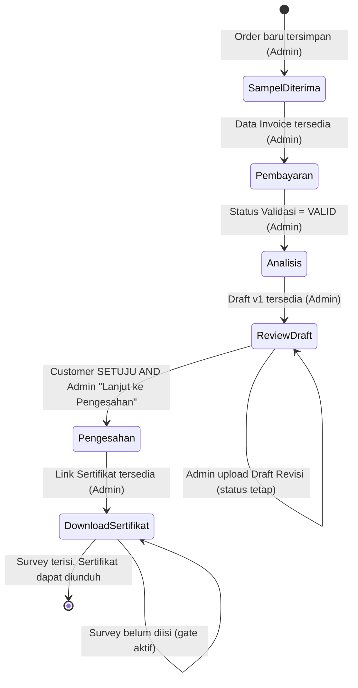

# SYSTEM DESIGN SPECIFICATION v1.0
## Sistem Tracking Sampel Laboratorium KTNT UNPAD

*Dokumen ini menerjemahkan FINAL REQUIREMENT BASELINE v1.0 menjadi desain sistem konseptual. Tidak berisi kode, skema SQL, atau implementasi. Seluruh keputusan bisnis mengacu ke baseline dan tidak dibuka kembali di sini.*

---

## BAGIAN 1 — System Overview

```
Admin
  ↓ (input & aktivitas operasional)
Google Sheets (ORDER, PENERIMAAN, PAYMENT, DRAFT, SURVEY, DB, PAR, dst.)
  ↓ (dibaca berkala)
Synchronization / Automation Layer
  ↓ (menerjemahkan data menjadi status & event)
Backend
  ↓ (menyimpan, memproses, menyediakan data)
Database
  ↓ (menyediakan data terstruktur)
Frontend Customer
```

Komponen pendukung: **Google Drive** (penyimpanan file — invoice, bukti bayar, kwitansi, draft, sertifikat), **Email** dan **WhatsApp** (kanal notifikasi otomatis).

**Tanggung jawab tiap komponen:**
- **Admin** — sumber kebenaran operasional. Seluruh aktivitas bisnis (input order, kategori customer, invoice, validasi pembayaran, upload draft/sertifikat/kwitansi, business action "Lanjut ke Pengesahan") dilakukan di Google Sheets, bukan lewat dropdown status manual.
- **Google Sheets** — media kerja admin yang sudah familiar (FINAL, tidak diganti). Menyimpan data mentah operasional.
- **Synchronization/Automation Layer** — membaca perubahan data di Sheets secara berkala, menerjemahkannya menjadi *event bisnis* (bukan status yang diketik admin), dan menerapkan aturan transisi status ke Database.
- **Backend** — melayani permintaan Frontend, menjalankan Automation Layer, mengelola notifikasi, menghubungkan ke Drive.
- **Database** — sumber kebenaran runtime untuk Frontend (cepat, terstruktur), hasil sinkronisasi dari Sheets.
- **Frontend Customer** — satu-satunya antarmuka customer; tanpa login, akses via ORDER NO.
- **Google Drive** — penyimpanan seluruh dokumen (invoice, bukti bayar, kwitansi, draft, sertifikat), link disimpan balik ke Sheets/Database.
- **Email/WhatsApp** — dikirim otomatis oleh Backend berdasarkan event status, sesuai Notification Requirement baseline.

Pola arsitektur ini **melanjutkan** pola yang sudah terbukti bekerja pada sistem sebelumnya (Sheets sebagai master admin, sinkronisasi berkala ke Database, Backend melayani Frontend) — bukan perombakan pola dasar, hanya perluasan cakupan data dan penggantian logika transisi status dari manual menjadi berbasis event.

---

## BAGIAN 2 — System Actors

### Admin Lab
**Tanggung jawab:** Mengelola seluruh data operasional order, pembayaran, draft, sertifikat via Google Sheets; melakukan validasi dan business action tertentu.
**Data yang dapat dibuat:** Order baru, data invoice, data kwitansi, entri draft (baru/revisi), entri sertifikat (baru/revisi).
**Data yang dapat diubah:** Kategori customer, Status Validasi Pembayaran, Tindak Lanjut Admin (business action pada DRAFT).
**Aktivitas yang memicu workflow:** Input order → memicu status Sampel Diterima; isi invoice → kandidat trigger Pembayaran; validasi pembayaran → trigger Analisis; upload draft → trigger Review Draft; "Lanjut ke Pengesahan" → trigger Pengesahan (bersyarat); upload sertifikat → trigger Download Sertifikat.
**Batasan tegas:** Admin **tidak pernah** mengubah dropdown status tracking secara langsung — ini prinsip arsitektur yang mengikat seluruh desain di dokumen ini.

### Customer
**Tanggung jawab:** Memantau status via ORDER NO., melakukan aksi yang menjadi bagiannya dalam alur (pilih faktur, upload bukti bayar, keputusan draft, isi survey).
**Data yang dapat dibuat:** Jenis Faktur, NPWP, bukti pembayaran (file), Keputusan Draft (SETUJU/REVISI), jawaban Survey.
**Data yang dapat diubah:** Tidak ada — customer hanya mencatat keputusan baru, tidak mengedit data yang sudah ada.
**Aktivitas yang memicu workflow:** Klik Setuju/Minta Revisi → mencatat Keputusan Customer (tidak langsung mengubah status); submit Survey → membuka akses download (tidak mengubah status).

### System / Automation
**Tanggung jawab:** Membaca event dari Sheets/aksi web, menerapkan aturan transisi status, mengirim notifikasi, menulis balik data tertentu ke Sheets (mis. Keputusan Customer, Tanggal Keputusan).
**Data yang dapat dibuat:** Log status/tracking, data notifikasi, penulisan balik tanggal/flag ke sheet DRAFT.
**Data yang dapat diubah:** Status tracking order (satu-satunya pihak yang berwenang mengubah status, murni berdasarkan aturan otomatis — bukan input manual).
**Aktivitas yang memicu workflow:** Deteksi perubahan data di Sheets (event-driven), aksi customer di web.

---

## BAGIAN 3 — Final State Machine



**Transition Rules (FINAL, mengikat):**
1. Setiap transisi hanya bisa **maju**, sesuai urutan lifecycle 6 status — konsisten dengan pola existing "sinkronisasi hanya maju" yang sudah terbukti bekerja pada sistem sebelumnya.
2. **Review Draft adalah status dengan self-loop terbanyak** — Setuju, Minta Revisi, dan Upload Draft Revisi semuanya **tidak mengubah status**, hanya mengubah data internal (Keputusan Customer, Versi Draft).
3. **Transisi keluar dari Review Draft memerlukan syarat ganda (AND)**: `Keputusan Customer = SETUJU` **DAN** `Tindak Lanjut Admin = LANJUT KE PENGESAHAN`. Tidak ada jalur lain menuju Pengesahan.
4. **Survey bukan status terpisah** dalam state machine — ia adalah *gate* di dalam status Download Sertifikat yang mengontrol ketersediaan aksi "download", bukan mengontrol status tracking itu sendiri.
5. Tidak ada transisi mundur di seluruh state machine ini (konsisten dengan Requirement #4 baseline).

---

## BAGIAN 4 — Data Domain

### Order
**Tujuan:** Representasi inti satu sampel/pesanan yang dilacak.
**Data utama:** ORDER NO., RECEIVED ON, WORK, Kategori Customer, Status Tracking saat ini.
**Relasi konseptual:** Induk bagi domain Payment, Draft, Certificate, Survey, Tracking/Status, Notification.
**Pemilik data:** Admin (pembuat), System (pengelola status).
**Sumber data:** Sheet ORDER.

### Customer
**Tujuan:** Identitas pihak yang menitipkan sampel.
**Data utama:** Nama/Perusahaan, Alamat, Kontak.
**Relasi konseptual:** Satu Customer dapat memiliki banyak Order.
**Pemilik data:** Admin.
**Sumber data:** Sheet ORDER/DB.

### Payment
**Tujuan:** Mengelola siklus finansial satu order — invoice, faktur pajak, bukti bayar, validasi, kwitansi.
**Data utama:** Link/No/Tanggal Invoice, Jenis Faktur, NPWP, Bukti Bayar, Status Validasi, Link Kwitansi, Kategori Customer → Rekening.
**Relasi konseptual:** Terhubung 1:N ke Order (mengikuti pola existing yang mendukung cicilan/multi-baris pembayaran).
**Pemilik data:** Admin (invoice, validasi, kwitansi), Customer (faktur, NPWP, bukti bayar).
**Sumber data:** Sheet PAYMENT.

### Draft
**Tujuan:** Mengelola hasil pengujian sementara yang perlu direview dan disetujui customer, termasuk siklus revisi.
**Data utama:** Versi Draft, Link Draft, Tanggal Upload, Keputusan Customer, Tanggal Keputusan, Tindak Lanjut Admin, Tanggal Tindak Lanjut.
**Relasi konseptual:** 1 Order dapat memiliki banyak baris Draft (repeatable, per versi).
**Pemilik data:** Admin (upload), Customer (keputusan), Admin (tindak lanjut).
**Sumber data:** Sheet DRAFT (baru).

### Certificate
**Tujuan:** Dokumen final hasil pengujian.
**Data utama:** Link Sertifikat, Tanggal Terbit.
**Relasi konseptual:** 1:1 terhadap Order (tanpa histori versi, sesuai keputusan final).
**Pemilik data:** Admin.
**Sumber data:** Kolom baru di ORDER/PENERIMAAN (bukan sheet terpisah).

### Survey
**Tujuan:** Menangkap kepuasan pelanggan sebagai syarat sebelum download sertifikat.
**Data utama:** Jawaban 14 pertanyaan skala, Kritik & Saran, konteks read-only (Order No., Nama, Jenis Sampel), tanggal submit.
**Relasi konseptual:** 1 Order menghasilkan 1 entri Survey (sesuai flow — tidak berulang dalam siklus normal).
**Pemilik data:** Customer (jawaban), System (konteks read-only ditarik dari Order).
**Sumber data:** Sheet SURVEY (baru), sebagian ditarik dari sheet ORDER.

### Tracking / Status
**Tujuan:** Merepresentasikan posisi order dalam lifecycle 6-tahap dan riwayatnya.
**Data utama:** Status saat ini, riwayat transisi (log), sumber transisi (event apa yang memicu).
**Relasi konseptual:** 1 Order memiliki 1 status aktif dan N riwayat log.
**Pemilik data:** System (satu-satunya penulis status).
**Sumber data:** Diturunkan dari event di seluruh domain lain (Payment, Draft, Certificate).

### Notification
**Tujuan:** Mencatat dan mengirim pemberitahuan Email/WhatsApp pada event kunci.
**Data utama:** Event pemicu, kanal (Email/WA), status kirim.
**Relasi konseptual:** N notifikasi per Order, dipicu oleh transisi status/event tertentu.
**Pemilik data:** System.
**Sumber data:** Dihasilkan otomatis oleh Automation Layer.

### File / Document
**Tujuan:** Representasi seluruh dokumen yang mengalir dalam sistem (invoice, bukti bayar, kwitansi, draft, sertifikat).
**Data utama:** Link file (Google Drive), tipe dokumen, order terkait.
**Relasi konseptual:** N file per Order, tersebar di domain Payment/Draft/Certificate.
**Pemilik data:** Admin (upload sebagian besar), Customer (upload bukti bayar).
**Sumber data:** Google Drive, link disimpan di Sheets terkait.

---

## BAGIAN 5 — Spreadsheet Architecture

### Peran Sheet Existing yang Relevan
- **ORDER** — sumber data induk order (master); satu-satunya tempat data sampel & customer pertama kali dibuat.
- **PENERIMAAN** — *view* turunan dari ORDER (via lookup), ditambah data pendukung estimasi (DATE OF ANALYSIS, WORK, ANALYSIS FINISH).
- **PAYMENT** — ledger transaksi finansial per order, mendukung banyak baris per order (cicilan).
- **DB** — tabel referensi/lookup lintas domain (termasuk mapping Kategori Pembayaran → Rekening, yang menjadi dasar pemahaman rekening BNI/Mandiri meski relasinya perlu disesuaikan ke Kategori Customer, bukan ke metode transaksi).
- **PAR** — legenda kode huruf sampel (S/O/L/I/C/B/M/P/A) → daftar parameter uji; sumber pemahaman bahwa CODE = representasi Jenis Analisis (relevan untuk Pending Mapping #2 di Bagian 18).

### ORDER
**Existing (dipertahankan):** ORDER NO. (kolom H — sumber tracking), CODE (I/L/P dst.), RECEIVED ON, WORK, NAME, ADDRESS, CONTACT, dan seluruh kolom administratif sampling.
**Kolom Baru:** `KATEGORI_CUSTOMER` (Rekanan UNPAD / Umum).
**Alasan:** Nilai tunggal per order, diketahui sejak awal, paling logis ditentukan bersamaan dengan pembuatan order — konsisten dengan keputusan baseline.

### PAYMENT
**Existing (dipertahankan):** Nama, CODE, ORDER NO., TOTAL, DISKON, PERCEPATAN, REFORMULA, PAJAK, JUMLAH, SISA, NO (cicilan), NOMINAL, TANGGAL, CARA, NO. KWITANSI, TANGGAL TEXT, KETERANGAN.
**Kolom Baru:** `LINK_INVOICE`, `NO_INVOICE`, `TANGGAL_INVOICE`, `STATUS_VALIDASI`, `JENIS_FAKTUR`, `NPWP`, `LINK_KWITANSI`.
**Alasan:** Seluruh data ini bersifat nilai tunggal per transaksi pembayaran, dan secara alami menyambung ke data finansial yang sudah ada di sheet ini — tidak memerlukan struktur repeatable terpisah.

### DRAFT (Sheet Baru)
**Alasan:** Data draft bersifat repeatable (0–N versi per order termasuk revisi) — memaksakan ke kolom akan menciptakan pola `link_v1, status_v1, link_v2, ...` yang tidak scalable dan rawan kesalahan admin, sebagaimana sudah dianalisis di baseline.
**Field:** Order No., Versi Draft, Link Draft, Tanggal Upload, Keputusan Customer, Tanggal Keputusan, Tindak Lanjut Admin, Tanggal Tindak Lanjut.

### SURVEY (Sheet Baru)
**Alasan:** Struktur data survey (14 jawaban + saran per order) sama sekali berbeda dari sheet operasional manapun; memaksakan ke ORDER akan merusak kerapian sheet yang dipakai admin harian.
**Field konseptual:** Order No., konteks (Nama, Jenis Sampel — ditarik dari Order), 14 jawaban skala, Kritik & Saran, Tanggal Submit.

### CERTIFICATE
**Keputusan:** **Cukup kolom di sheet existing** (ORDER atau PENERIMAAN), **tidak perlu sheet baru**.
**Alasan:** Baseline sudah final bahwa histori versi sertifikat tidak diperlukan untuk requirement saat ini — sertifikat bersifat 1:1 terhadap order dan cukup di-overwrite saat revisi. Sheet baru hanya dijustifikasi untuk data repeatable (seperti Draft); karena sertifikat tidak repeatable dalam desain saat ini, kolom biasa sudah cukup dan lebih sederhana.
**Field:** `LINK_SERTIFIKAT`, `TANGGAL_TERBIT`.

---

## BAGIAN 6 — Data Flow

**Admin input Order:**
```
Admin isi ORDER (Sheets) → Automation Layer membaca perubahan
→ Data tersimpan ke Database → Status: Sampel Diterima
→ Frontend Customer dapat menampilkan data begitu Database ter-update
```

**Customer upload bukti pembayaran:**
```
Customer pilih file di Frontend → Backend terima file
→ File disimpan ke Google Drive → Link disimpan ke Database (dan ditulis balik ke sheet PAYMENT)
→ Data bukti bayar tersedia untuk dilihat Admin di Sheets
```

**Customer pilih Faktur/Non Faktur + NPWP:**
```
Customer input di Frontend halaman Pembayaran → Backend simpan ke Database
→ Ditulis balik ke sheet PAYMENT (kolom JENIS_FAKTUR, NPWP)
```

**Customer Setuju/Minta Revisi Draft:**
```
Customer klik di Frontend → Backend catat Keputusan + Tanggal ke Database
→ Ditulis balik ke sheet DRAFT (kolom Keputusan Customer, Tanggal Keputusan)
→ Status TIDAK berubah pada titik ini
```

**Customer Submit Survey:**
```
Customer isi jawaban di Frontend → Backend simpan ke Database
→ Ditulis ke sheet SURVEY (baru) untuk kebutuhan pelaporan Lab
→ Gate download terbuka (flag internal, bukan perubahan status tracking)
```

**Pola umum:** Data mengalir dua arah — mayoritas **Sheets → Database → Frontend** (aktivitas admin), dengan penulisan balik terbatas **Frontend → Database → Sheets** (aktivitas customer yang perlu terlihat admin: bukti bayar, faktur/NPWP, keputusan draft, jawaban survey). Pola ini melanjutkan arsitektur sinkronisasi dua-arah terbatas yang sudah ada di sistem existing.

---

## BAGIAN 7 — Automation Architecture

```
EVENT: Order baru tersimpan di ORDER
ACTION: Create tracking record → Status: Sampel Diterima
        Send notification (Email + WA)

EVENT: Data Invoice tersedia (LINK_INVOICE terisi)
ACTION: Update status → Pembayaran
        (Tidak ada notifikasi otomatis, sesuai baseline)

EVENT: Status Validasi = VALID
ACTION: Update status → Analisis
        Send notification (Email + WA)

EVENT: Kwitansi tersedia (LINK_KWITANSI terisi)
ACTION: Tampilkan pada event "Pembayaran Terverifikasi" di Timeline
        Status TIDAK berubah

EVENT: Draft v1 diupload
ACTION: Update status → Review Draft
        Send notification (Email + WA)

EVENT: Customer memilih SETUJU
ACTION: Record Keputusan Customer = SETUJU + Tanggal
        Status TETAP Review Draft
        Kirim feedback in-app (bukan Email/WA)

EVENT: Customer memilih MINTA REVISI
ACTION: Record Keputusan Customer = REVISI + Tanggal
        Status TETAP Review Draft
        (Tidak ada notifikasi ke customer pada titik ini)

EVENT: Admin upload Draft Revisi (versi baru)
ACTION: Insert baris Draft baru
        Status TETAP Review Draft
        Send notification khusus ("Draft hasil revisi telah tersedia")

EVENT: Admin memilih Tindak Lanjut = "Lanjut ke Pengesahan"
ACTION: Validate — Keputusan Customer pada versi draft terkait harus = SETUJU
        Jika valid: Update status → Pengesahan; Send notification (Email + WA)
        Jika tidak valid: Action ditolak/tidak berefek pada status (lihat Bagian 16 edge case)

EVENT: Link Sertifikat tersedia
ACTION: Update status → Download Sertifikat
        Send notification (Email + WA)

EVENT: Customer submit Survey
ACTION: Simpan jawaban survey
        Buka gate download (flag, bukan status)
        (Tidak ada notifikasi otomatis)

EVENT: Admin upload ulang Sertifikat (revisi, di luar sistem via WA)
ACTION: Update LINK_SERTIFIKAT
        Status TETAP Download Sertifikat
        (Tidak ada notifikasi otomatis baru, sesuai baseline)
```

---

## BAGIAN 8 — Payment Design

```
Kategori Customer (ditentukan Admin)
        ↓
Rekening ditentukan otomatis oleh sistem:
   Rekanan UNPAD → BNI
   Umum → Mandiri
   (CASH tidak menjadi opsi yang ditampilkan di website)
        ↓
Invoice (disediakan Admin) → ditampilkan ke Customer
        ↓
Customer pilih Faktur Pajak / Non Faktur
        ↓
   [Faktur Pajak] → NPWP wajib diisi
        ↓
Customer upload Bukti Bayar
        ↓
Admin melakukan Validasi → Status Validasi:

   PENDING  → kondisi awal setelah bukti bayar diupload, menunggu tindakan Admin.
              Status tracking tetap Pembayaran.

   VALID    → Admin mengonfirmasi pembayaran benar.
              Status tracking otomatis → Analisis. Notifikasi terkirim.

   INVALID  → Admin menandai bukti bayar tidak sah/tidak sesuai.
              Status tracking tetap Pembayaran.
              (Perilaku lanjutan — apakah customer diminta upload ulang — 
               tidak dirinci lebih lanjut di baseline; dicatat sebagai
               ASSUMPTION bahwa customer dapat mengunggah ulang bukti baru.)
```

**FINAL DESIGN DECISION:** Status Validasi adalah field eksplisit tiga-kondisi (PENDING/VALID/INVALID), bukan diturunkan dari perhitungan SISA=0 — sesuai baseline yang menandai proxy tersebut tidak cukup andal.

---

## BAGIAN 9 — Draft Design

**Bagaimana sistem mengetahui draft terbaru:** Setiap unggahan draft baru (baik versi awal maupun revisi) menjadi baris baru di sheet DRAFT dengan nomor Versi Draft bertambah. Sistem mengidentifikasi draft terbaru sebagai baris dengan Versi Draft tertinggi untuk Order NO. yang bersangkutan.

**Bagaimana keputusan customer dikaitkan dengan draft:** Kolom Keputusan Customer dan Tanggal Keputusan berada **pada baris versi draft yang sama** yang sedang direview — sehingga keputusan SETUJU/REVISI selalu jelas merujuk ke versi draft spesifik, bukan ke order secara umum. Ini penting terutama pada siklus revisi berulang, di mana setiap versi draft punya keputusan customernya sendiri.

**Bagaimana sistem memastikan Admin hanya bisa lanjut ke Pengesahan setelah Customer SETUJU:** Business action "Lanjut ke Pengesahan" hanya berlaku sah (menyebabkan status berubah) jika Keputusan Customer pada versi draft **terbaru** = SETUJU. Jika Admin memilih action ini padahal Keputusan Customer belum SETUJU (kosong atau masih REVISI), sistem **tidak mengubah status** — ini dijelaskan sebagai edge case eksplisit di Bagian 16, bukan diasumsikan aman.

**Riwayat versi draft:** Data historis (seluruh versi, bukan hanya terbaru) tetap tersimpan di sheet DRAFT secara alami (setiap versi = baris terpisah, tidak di-overwrite) — namun **penyajian riwayat ke customer di Frontend tetap OPTIONAL**, sesuai baseline, bukan requirement wajib tahap ini.

---

## BAGIAN 10 — Certificate Design

```
Admin upload Sertifikat (Link Sertifikat terisi)
        ↓
Status → Download Sertifikat
        ↓
Survey Gate: Customer wajib isi Survey sebelum tombol Download aktif
        ↓
Customer Download Sertifikat
```

**Sertifikat Revisi (di luar sistem):**
```
Customer menemukan kesalahan → hubungi Admin via WhatsApp (DI LUAR SISTEM)
Admin memproses revisi secara internal (DI LUAR SISTEM)
Admin upload ulang Link Sertifikat → field LINK_SERTIFIKAT di-overwrite
Website otomatis menampilkan sertifikat versi terbaru
Customer download ulang
```

**FINAL DESIGN DECISION (mengikat, tidak dibuka kembali):** Tidak ada workflow/tombol/form pengajuan revisi sertifikat di dalam sistem. Batas waktu 14 hari kerja ditampilkan sebagai informasi pasif saja, dihitung sejak Tanggal Terbit — sistem tidak menegakkan/memblokir apa pun setelah 14 hari (murni informational, tidak ada validasi otomatis yang menolak revisi setelah lewat batas, karena prosesnya di luar sistem).

---

## BAGIAN 11 — Survey Design

**Order linkage:** Survey selalu terikat pada Order NO. yang sedang dibuka customer (dari konteks navigasi/tracking yang sudah aktif) — tidak ada input Order No. manual di form survey.

**Read-only context:** Header informasi (Order No., Nama Customer, Jenis Sampel) ditarik otomatis dari data Order dan ditampilkan sebagai teks statis, bukan field input.

**14 pertanyaan + Kritik & Saran:** Struktur soal mengikuti persis FINAL SURVEY REQUIREMENT — Bagian I (4 pertanyaan), Bagian II (3), Bagian III (6), Bagian IV (1 — Akurasi Hasil Uji), ditutup Kritik & Saran (isian bebas). Tidak ada penambahan/pengurangan pertanyaan pada tahap desain ini.

**Bintang + teks:** Setiap pilihan jawaban direpresentasikan sebagai satu unit gabungan (posisi bintang + label teks resmi) yang dipilih sebagai satu kesatuan — bukan dua kontrol input terpisah yang berisiko tidak sinkron.

**Mapping nilai:** Posisi 1–5 konsisten untuk seluruh bagian; label teks berbeda khusus Bagian IV (Sangat Baik/Baik, bukan Sangat Puas/Puas) sesuai formulir asli — dipertahankan apa adanya sesuai baseline.

**Submission:** Satu kali submit menyimpan seluruh 15 jawaban (14 skala + 1 isian bebas) sekaligus sebagai satu entri Survey per Order.

**Survey sebagai download gate:** Ketersediaan tombol Download pada status Download Sertifikat bergantung pada keberadaan entri Survey untuk Order tersebut — bukan bagian dari state machine status tracking (lihat Bagian 3).

---

## BAGIAN 12 — Estimation Design

```
Input: WORK (jumlah hari kerja, dari Admin) + Tanggal Mulai (RECEIVED ON)
Proses: Hitung Tanggal Selesai dengan menghitung maju sejumlah WORK hari,
        melewati (skip) setiap hari yang jatuh pada Sabtu atau Minggu.
Output: Estimasi Hari Kerja (= nilai WORK) + Estimasi Tanggal Selesai
```

**Perbedaan dari mekanisme existing (dicatat, bukan diubah tanpa sadar):** Spreadsheet saat ini menggunakan tabel lookup tetap (WORK=7→+10 hari kalender, dst.) — bukan penghitungan hari-kerja dinamis yang skip Sabtu/Minggu. Desain baru ini **menggantikan logika perhitungan**, sementara nilai input WORK tetap dipakai dari kolom yang sama.

**Warning:**
```
KONDISI: (Estimasi Hari Kerja tersisa <= 2) DAN (Status saat ini = Analisis)
AKSI: Tampilkan warning pasif di halaman tracking (bukan notifikasi Email/WA)
      Wording: "Estimasi penyelesaian tinggal 2 hari kerja. Jika Anda memiliki
      pertanyaan mengenai progres pengujian, silakan hubungi admin Lab KTNT."
```

Tidak ada formula teknis dibahas di tahap ini, sesuai batasan dokumen.

---

## BAGIAN 13 — File / Document Flow

| Dokumen | Siapa Upload | Siapa Melihat | Sumber | Kapan Tersedia | Mengganti Versi Sebelumnya? | Memengaruhi Status? |
|---|---|---|---|---|---|---|
| Invoice | Admin | Customer | Google Drive (link di PAYMENT) | Setelah Admin isi data invoice | Ya, di-overwrite | Ya — trigger status Pembayaran |
| Bukti Pembayaran | Customer | Admin | Google Drive (upload dari web) | Setelah Customer upload | Tidak dijelaskan eksplisit di baseline — **ASSUMPTION**: upload baru menjadi entri baru mengikuti pola existing (mendukung banyak baris pembayaran/cicilan) | Tidak langsung — hanya melalui hasil Validasi Admin |
| Kwitansi | Admin | Customer (di Timeline) | Google Drive (link di PAYMENT) | Setelah Admin upload | Ya, di-overwrite | Tidak — murni informasi tambahan |
| Draft | Admin | Customer | Google Drive (link di DRAFT) | Setelah Admin upload versi baru | Tidak — setiap versi tersimpan sebagai baris baru (riwayat tetap ada) | Ya — versi 1 trigger status Review Draft; versi revisi tidak mengubah status tapi memicu notifikasi |
| Sertifikat | Admin | Customer | Google Drive (link di ORDER/PENERIMAAN) | Setelah Admin upload | Ya, di-overwrite (tanpa histori, sesuai keputusan final) | Ya — trigger status Download Sertifikat |

---

## BAGIAN 14 — Notification Architecture

| Event | Email | WhatsApp | In-App |
|---|---|---|---|
| Order baru (Sampel Diterima) | ✓ | ✓ | — |
| Data Invoice tersedia (masuk Pembayaran) | — | — | — |
| Pembayaran tervalidasi (masuk Analisis) | ✓ | ✓ | — |
| Draft v1 tersedia (masuk Review Draft) | ✓ | ✓ | — |
| Customer SETUJU tercatat | — | — | ✓ (feedback: "persetujuan tercatat, menunggu admin") |
| Customer MINTA REVISI tercatat | — | — | — |
| Draft revisi tersedia | ✓ | ✓ (wording khusus, beda dari draft awal) | — |
| Admin "Lanjut ke Pengesahan" (masuk Pengesahan) | ✓ | ✓ | — |
| Sertifikat tersedia (masuk Download Sertifikat) | ✓ | ✓ | — |
| Survey submit | — | — | — |
| Sertifikat direvisi (upload ulang) | — | — | — |

*Matrix ini identik dengan Notification Requirement final di baseline — tidak ada penambahan event notifikasi baru.*

---

## BAGIAN 15 — Frontend Information Flow

**Landing Page:** Menampilkan identitas Lab (nama, Logo KAN, deskripsi resmi), foto laboratorium, penjelasan kemampuan tracking real-time, kontak lengkap, footer. Aksi tersedia: navigasi ke halaman pencarian tracking. Tidak ada kondisi kosong/error (konten statis).

**Tracking Page (pencarian):** Input Nomor Order. Aksi tersedia: submit pencarian. Kondisi error: Order No. tidak ditemukan → pesan jelas, arahkan coba lagi.

**Status/Tracking Detail Page:** Menampilkan timeline 6 status, estimasi (Hari Kerja + Tanggal Selesai), warning bila berlaku, serta panel kontekstual sesuai status aktif:
- Status Pembayaran → tampil panel Invoice, form Faktur/NPWP, info rekening, upload bukti bayar.
- Status Analisis → info progres + kwitansi (bila tersedia) di Timeline.
- Status Review Draft → panel Draft dengan tombol Setuju/Minta Revisi (aktif hanya bila Keputusan Customer belum tercatat untuk versi draft terbaru; setelah tercatat, tombol nonaktif dan berganti pesan status).
- Status Pengesahan → info pasif (tidak ada aksi customer).
- Status Download Sertifikat → panel Survey (bila belum diisi) atau panel Download + info batas revisi (bila Survey sudah diisi).

**Payment Page (bagian dari Status Page):** Kondisi kosong: Invoice belum tersedia → tampilkan pesan "menunggu admin", sembunyikan form upload. Tombol upload bukti bayar aktif hanya setelah Invoice tersedia.

**Draft Review (bagian dari Status Page):** Tombol Setuju/Minta Revisi nonaktif setelah salah satu dipilih (mencegah submit ganda) hingga versi draft baru tersedia (revisi) atau status berubah (pengesahan).

**Survey Page:** Aktif hanya saat status = Download Sertifikat dan Survey belum pernah disubmit. Kondisi: bila Survey sudah pernah disubmit, halaman ini tidak relevan lagi — Customer langsung diarahkan ke Certificate Page.

**Certificate Page:** Tombol Download nonaktif bila Survey belum diisi (redirect ke Survey), aktif setelah Survey tersimpan. Menampilkan info tanggal terbit, batas revisi 14 hari kerja, kontak WhatsApp admin.

---

## BAGIAN 16 — Edge Case

| Edge Case | Kondisi | Risiko | Expected Behavior |
|---|---|---|---|
| Invoice belum tersedia | Customer di status Pembayaran, Admin belum isi invoice | Customer bingung tidak ada info tagihan | Tampilkan pesan "invoice sedang diproses admin", sembunyikan form upload bukti bayar |
| Customer belum upload pembayaran | Invoice sudah ada, tapi belum ada bukti bayar | Status stuck tanpa kejelasan | Tampilkan status "menunggu pembayaran", tidak ada perubahan otomatis |
| Pembayaran INVALID | Admin menandai bukti bayar salah | Customer tidak tahu harus apa | Status tetap Pembayaran; perlu indikasi ke customer bahwa bukti ditolak dan diminta unggah ulang (**ASSUMPTION**, lihat Bagian 8) |
| Customer pilih Faktur tapi NPWP kosong | Validasi form di titik input | Data tidak lengkap tersimpan | Sistem mencegah lanjut ke upload bukti bayar sebelum NPWP terisi valid |
| Customer minta revisi draft | Customer klik Minta Revisi | — | Status tetap Review Draft, Admin mendapat sinyal, tombol keputusan nonaktif menunggu draft revisi baru |
| Customer setuju draft | Customer klik Setuju | Customer mengira status langsung berubah | Tampilkan pesan eksplisit "tercatat, menunggu proses pengesahan admin" agar tidak ada ekspektasi salah |
| **Admin mencoba "Lanjut ke Pengesahan" sebelum Customer setuju** | Tindak Lanjut Admin dipilih padahal Keputusan Customer masih kosong/REVISI | Status bisa salah berubah bila tidak divalidasi | Sistem **menolak** menerapkan transisi status; status tetap Review Draft meski field Tindak Lanjut Admin sudah diisi Admin (perlu indikasi kembali ke Admin bahwa syarat belum terpenuhi) |
| Draft revisi tersedia | Admin upload versi baru | Customer bisa bingung mana draft yang berlaku | Sistem selalu menampilkan versi tertinggi sebagai draft aktif; notifikasi khusus dikirim |
| Sertifikat belum tersedia | Status masih Pengesahan | Customer menunggu tanpa kejelasan | Tampilkan info status sedang diproses, tanpa akses ke Survey/Download |
| Survey belum selesai | Status Download Sertifikat, Survey belum disubmit | Customer tidak bisa download | Tombol Download tetap nonaktif, arahkan ke Survey |
| Sertifikat direvisi | Admin upload ulang link sertifikat | Customer bisa mengunduh versi lama dari cache/tab lama | Sistem selalu menyajikan link terbaru saat halaman dimuat/di-refresh; tidak ada mekanisme push otomatis (customer perlu refresh) |
| Estimasi hampir habis | Sisa ≤2 hari kerja, status masih Analisis | Warning tidak relevan bila status sudah lanjut | Warning hanya tampil bila kedua syarat terpenuhi bersamaan; otomatis hilang bila status berubah |
| Data spreadsheet tidak lengkap | Baris ORDER/PAYMENT/DRAFT punya field kosong yang dibutuhkan sistem | Sinkronisasi gagal/salah proses | Baris dengan data wajib kosong dilewati saat sinkronisasi (konsisten dengan pola existing "skip baris tidak valid"), tanpa menghentikan seluruh proses sinkronisasi lain |
| Duplicate event | Admin tidak sengaja input ulang data yang sama (misal invoice diisi dua kali) | Notifikasi terkirim ganda | Sistem hanya memproses event pada **perubahan pertama kali** data terisi/berubah, bukan setiap kali dibaca ulang (idempotent per perubahan) |
| File/link tidak valid | Admin memasukkan link rusak/bukan URL valid | Customer klik tapi gagal buka dokumen | Validasi format link minimal sebelum dianggap "tersedia" sebagai trigger status; link yang gagal validasi tidak memicu transisi status |

---

## BAGIAN 17 — System Design Decision

| Area | Decision | Reason | Status |
|---|---|---|---|
| State Management | Status tracking hanya diubah oleh System, berdasarkan event; tidak ada mekanisme edit manual | Konsisten dengan Requirement #4 (otomatisasi penuh) | FINAL DESIGN DECISION |
| State Management (Draft→Pengesahan) | Transisi memerlukan syarat AND (Keputusan Customer SETUJU + Admin Action) | Sesuai revisi flow final baseline | FINAL DESIGN DECISION |
| Spreadsheet | ORDER/PENERIMAAN/PAYMENT dipertahankan + kolom baru; DRAFT & SURVEY sheet baru; Certificate cukup kolom | Mengikuti prinsip "pertahankan familiar, sheet baru hanya untuk data repeatable" | FINAL DESIGN DECISION |
| Payment | Status Validasi eksplisit 3-kondisi (PENDING/VALID/INVALID), bukan proxy SISA=0 | SISA=0 dinilai tidak cukup andal sebagai sinyal validasi niat admin | FINAL DESIGN DECISION |
| Draft | Keputusan Customer melekat per-versi draft, bukan per-order | Memastikan kejelasan keputusan mana yang berlaku saat ada siklus revisi berulang | FINAL DESIGN DECISION |
| Certificate | Tanpa histori versi, field di-overwrite | Sesuai keputusan final baseline (Bagian D) | FINAL DESIGN DECISION |
| Survey | Konteks read-only ditarik dari Order, tidak diinput ulang customer | Sesuai FINAL SURVEY REQUIREMENT | FINAL DESIGN DECISION |
| Notification | Mengikuti matrix final, tanpa penambahan event baru | Sesuai Notification Requirement baseline | FINAL DESIGN DECISION |
| File Management | Seluruh dokumen disimpan di Google Drive, link disimpan di Sheets/Database terkait | Melanjutkan pola existing yang sudah terbukti bekerja | FINAL DESIGN DECISION |
| Estimation | Perhitungan hari kerja dinamis (skip Sabtu/Minggu) menggantikan lookup tetap existing | Sesuai requirement baru; WORK sebagai input tetap dipakai | FINAL DESIGN DECISION |
| Payment INVALID follow-up | Customer diasumsikan bisa upload ulang bukti bayar setelah ditandai INVALID | Belum dirinci eksplisit di baseline | **ASSUMPTION** — perlu dikonfirmasi saat Implementation Planning |
| Duplicate event handling | Event diproses hanya pada perubahan data pertama kali, bersifat idempotent | Mencegah notifikasi ganda | RECOMMENDATION (prinsip desain, detail teknis menyusul) |

---

## BAGIAN 18 — Pending Mapping

Berikut hal yang **belum diketahui tapi tidak menghambat desain** — murni detail teknis/pemetaan yang akan diselesaikan pada tahap berikutnya:

- Mapping kolom sumber untuk "Jenis Sampel" dan "No. Handphone" pada konteks Survey (dari kolom CODE/COMODITY/CONTACT di ORDER — perlu dipetakan presisi).
- Materi konten Landing Page (foto, deskripsi resmi, kontak terbaru, izin penggunaan Logo KAN) — menunggu disuplai Lab.
- Nama teknis final kolom baru di spreadsheet (working title saat ini bersifat sementara).
- Detail perilaku UI kecil (mis. format placeholder input pencarian tracking).
- Relasi CODE (I/L/P) terhadap ORDER NO. sebagai kode tracking, dan implikasinya terhadap Requirement #2 (Jenis Analisis tersembunyi) — sudah tercatat sebagai item yang perlu klarifikasi Lab di baseline, dibawa serta ke tahap Spreadsheet Mapping Specification berikutnya.
- Trigger pasti Sampel Diterima → Pembayaran (kandidat: Invoice tersedia) — sudah dipakai sebagai working assumption di seluruh dokumen ini, tapi tetap menunggu konfirmasi eksplisit Lab.

Tidak ada satu pun dari poin di atas yang diperlakukan sebagai requirement baru — seluruhnya murni pemetaan teknis lanjutan.

---

## BAGIAN 19 — Implementation Readiness

# READY FOR IMPLEMENTATION PLANNING?

**YES**

Seluruh domain desain (System Overview, Actors, State Machine, Data Domain, Spreadsheet Architecture, Data Flow, Automation, Payment, Draft, Certificate, Survey, Estimation, File Flow, Notification, Frontend Information Flow, Edge Case) sudah dirancang secara konsisten dengan FINAL REQUIREMENT BASELINE v1.0, tanpa kontradiksi internal. Item yang tersisa (Bagian 18) bersifat pemetaan teknis, bukan penghalang keputusan desain.

Tahap berikutnya:
1. Final Data Model
2. Spreadsheet Mapping Specification
3. API Contract
4. Frontend State/Flow Specification
5. Automation Specification
6. Implementation Task Breakdown

*(Keenam hal di atas tidak dibahas pada dokumen ini sesuai batasan tahap System Design.)*
