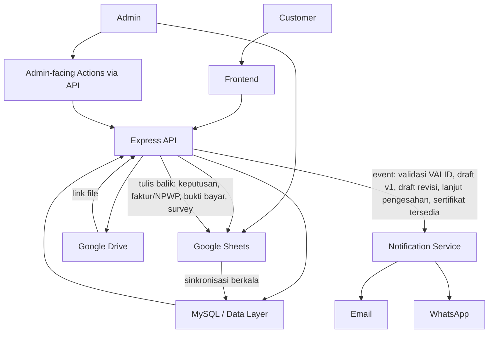

# API CONTRACT SPECIFICATION v1.0
## Sistem Tracking Sampel Laboratorium KTNT UNPAD

*Sumber: FINAL REQUIREMENT BASELINE v1.0, SYSTEM DESIGN SPECIFICATION v1.0, DATA MODEL & SPREADSHEET MAPPING SPECIFICATION v1.0. Dokumen ini mendefinisikan kontrak antar-layer secara konseptual — tanpa kode, tanpa implementasi Express/controller/service, tanpa SQL.*

---

## BAGIAN 1 — API Architecture Overview

```
Customer / Admin (Frontend)
        ↓
Express API (Contract Layer — didefinisikan di dokumen ini)
        ↓
MySQL / Data Layer (sumber kebenaran runtime untuk Frontend)
        ↓
Google Sheets / Google Drive (sumber kebenaran operasional Admin & penyimpanan file)
        ↓
External Notification Services (Email SMTP, WhatsApp/Fonnte)
```

**Tanggung jawab tiap layer:**
- **Frontend** — mengonsumsi API, tidak menyimpan logika bisnis; hanya menampilkan data dan mengirim aksi customer.
- **Express API** — satu-satunya pintu masuk permintaan; menegakkan rule validasi, otorisasi akses per-order, dan memicu Automation Layer saat data berubah.
- **MySQL/Data Layer** — menyimpan data terstruktur hasil sinkronisasi dari Sheets, sekaligus data yang ditulis langsung dari aksi customer (sebelum ditulis balik ke Sheets).
- **Google Sheets/Drive** — tetap menjadi media kerja Admin (FINAL, tidak diganti) dan penyimpanan file; API membaca perubahan dari sini dan menulis balik data tertentu (Keputusan Customer, dsb.).
- **Notification Services** — dipicu oleh Backend saat event status tertentu terjadi, bukan dipanggil langsung oleh Frontend.

Pola ini melanjutkan arsitektur "Sheets sebagai master operasional Admin, Database sebagai sumber kebenaran runtime Frontend" yang sudah ditetapkan di System Design Specification — tidak ada perubahan pola dasar.

---

## BAGIAN 2 — API Domain

| Domain | Tanggung Jawab |
|---|---|
| 1. Tracking/Order | Menyediakan data gabungan status, timeline, estimasi untuk satu order kepada customer |
| 2. Payment | Mengelola Faktur/NPWP, invoice, bukti bayar, validasi pembayaran, rekening |
| 3. Draft | Mengelola versi draft, keputusan customer, business action Admin menuju Pengesahan |
| 4. Certificate | Menyediakan akses sertifikat terbaru dan info batas revisi |
| 5. Survey | Mengelola pengisian survey sebagai gate download |
| 6. Notification | Memicu dan mencatat pengiriman Email/WhatsApp (dipanggil internal oleh domain lain, bukan endpoint publik) |
| 7. Admin/Spreadsheet Sync | Menyediakan titik baca-tulis khusus Admin dan mekanisme sinkronisasi dari Sheets |

---

## BAGIAN 3 — Tracking API

| Method | Endpoint (konseptual) | Actor | Purpose | Request | Response (garis besar) | Validation |
|---|---|---|---|---|---|---|
| GET | `/tracking/{order_no}` | Customer | Mengambil seluruh data tracking gabungan (status, timeline, estimasi, invoice ringkas, draft terbaru, sertifikat, survey completion) dalam satu panggilan | Order No. (path) | Data order, status aktif, riwayat timeline, estimasi hari kerja & tanggal selesai, ringkasan invoice, draft terbaru (bila ada), info sertifikat (bila ada), flag survey selesai, flag download diizinkan | Order No. harus ditemukan; format sesuai Requirement #5 |
| GET | `/tracking/{order_no}/status` | Customer | Mengambil current status + timeline saja (versi ringan bila full tracking tidak diperlukan) | Order No. | Status aktif, riwayat status | Sama seperti di atas |
| GET | `/tracking/{order_no}/estimation` | Customer | Mengambil estimasi hari kerja, tanggal selesai, dan flag warning | Order No. | Estimasi hari kerja, tanggal selesai, flag warning aktif/tidak | Sama seperti di atas |

**DESIGN DECISION:** Endpoint tracking utama (`GET /tracking/{order_no}`) dirancang sebagai satu panggilan gabungan (bukan dipecah ke banyak endpoint kecil per bagian informasi) — ini mengikuti pola yang sudah terbukti bekerja pada sistem sebelumnya (satu endpoint tracking mengembalikan order + history + certificate + latest_draft + survey_completed sekaligus). Endpoint status/estimation terpisah bersifat opsional sebagai pelengkap, bukan pengganti.

**ASSUMPTION:** Invoice, Kwitansi, Draft ringkas, dan info sertifikat cukup ditampilkan sebagai bagian dari respons `GET /tracking/{order_no}` (bukan endpoint terpisah per dokumen) karena seluruhnya adalah data read-only kontekstual terhadap satu order yang sama — perlu dikonfirmasi saat Frontend State/Flow Specification apakah pemecahan lebih lanjut diperlukan untuk alasan performa.

---

## BAGIAN 4 — Payment API

### Customer

| Method | Endpoint | Purpose | Request | Response | Validation |
|---|---|---|---|---|---|
| GET | `/tracking/{order_no}/payment` | Melihat detail pembayaran: invoice, rekening yang dipilih Admin, status validasi | Order No. | Data invoice, nama+nomor rekening (dari field REKENING_PEMBAYARAN yang diisi Admin: BNI=55414267 / Mandiri=63726257), status validasi saat ini | Order harus berstatus Pembayaran atau lebih lanjut |
| POST | `/tracking/{order_no}/payment/faktur` | Menyimpan pilihan Faktur Pajak/Non Faktur + NPWP | Jenis Faktur, NPWP (kondisional) | Konfirmasi tersimpan | NPWP wajib terisi jika Jenis Faktur = Faktur Pajak (lihat Bagian 15) |
| POST | `/tracking/{order_no}/payment/upload-proof` | Upload bukti pembayaran | File (multipart) | Konfirmasi + link file | Order harus punya Invoice tersedia terlebih dahulu (lihat Bagian 5) |

### Admin/System

| Method | Endpoint | Purpose | Request | Response | Validation |
|---|---|---|---|---|---|
| GET | `/admin/orders/{order_no}/payment` | Membaca detail pembayaran termasuk bukti pembayaran | Order No. | Data pembayaran lengkap + link bukti bayar | Akses Admin (lihat Bagian 16) |
| POST | `/admin/orders/{order_no}/payment/validate` | Melakukan validasi pembayaran | Status Validasi (VALID/INVALID) | Konfirmasi + status baru | Bukti pembayaran harus sudah ada (lihat Bagian 5) |

**Rekening — FINAL, ditegaskan ulang:** Rekening **tidak pernah menjadi input dari Customer** — endpoint `GET /tracking/{order_no}/payment` mengembalikan rekening yang **sudah dipilih Admin secara langsung** melalui field `REKENING_PEMBAYARAN` (BNI=55414267, Mandiri=63726257). Tidak ada field/konsep Kategori Customer. Tidak ada endpoint yang menerima pilihan rekening dari Customer. CASH tidak muncul sebagai opsi di respons API manapun yang diakses Frontend Customer.

---

## BAGIAN 5 — Payment Validation Flow

```
Customer POST /payment/upload-proof
   → Ditolak jika Invoice belum tersedia (lihat Bagian 15: Payment belum tersedia)
   → Bila diterima: bukti pembayaran tersimpan, Status Validasi = PENDING

Admin GET /admin/orders/{order_no}/payment
   → Admin melihat bukti pembayaran yang sudah diupload

Admin POST /admin/orders/{order_no}/payment/validate
   → Ditolak jika belum ada bukti pembayaran tersimpan
   → Ditolak jika Status Validasi saat ini sudah VALID (mencegah duplikasi validasi)
   → Bila VALID: status order otomatis berubah ke Analisis + notifikasi Email+WA terkirim
   → Bila INVALID: status order tetap Pembayaran, tidak ada notifikasi otomatis (ASSUMPTION dari Data Model Specification — customer dapat upload ulang, belum dikonfirmasi eksplisit)
```

**Bagaimana API mencegah:**
- **Validasi tanpa bukti pembayaran** — endpoint validasi memeriksa keberadaan bukti pembayaran tersimpan sebelum menerima permintaan validasi; ditolak bila kosong.
- **Status Analisis muncul sebelum validasi VALID** — transisi status **hanya** dipicu secara internal oleh endpoint validasi saat nilai yang diterima adalah VALID; tidak ada endpoint lain yang dapat mengubah status ke Analisis.
- **Duplikasi validasi** — endpoint validasi memeriksa Status Validasi saat ini; permintaan validasi ulang terhadap order yang sudah VALID ditolak (mencegah notifikasi terkirim berkali-kali).
- **Perubahan status manual yang tidak sah** — sesuai Bagian 9, tidak ada endpoint `PATCH/PUT status` apa pun yang tersedia untuk Admin atau siapa pun.

---

## BAGIAN 6 — Draft API

### Admin

| Method | Endpoint | Purpose | Request | Response | Validation |
|---|---|---|---|---|---|
| POST | `/admin/orders/{order_no}/draft` | Upload Draft baru (versi awal atau revisi) | Link Draft | Konfirmasi + Versi Draft baru | Bila versi=1: memicu status Review Draft. Bila revisi: versi sebelumnya harus berstatus Keputusan=REVISI |
| GET | `/admin/orders/{order_no}/draft` | Melihat seluruh riwayat versi draft + keputusan customer per versi | Order No. | Daftar draft (versi, link, keputusan, tanggal) | Akses Admin |
| POST | `/admin/orders/{order_no}/draft/proceed-to-pengesahan` | Business action "Lanjut ke Pengesahan" | Order No. (implisit dari path) | Konfirmasi + status baru (bila valid) | **Wajib**: Keputusan Customer pada versi draft terbaru = SETUJU (lihat Bagian 15) |

### Customer

| Method | Endpoint | Purpose | Request | Response | Validation |
|---|---|---|---|---|---|
| GET | `/tracking/{order_no}/draft/latest` | Melihat draft terbaru | Order No. | Link draft, versi, status keputusan saat ini | Draft harus sudah tersedia |
| POST | `/tracking/{order_no}/draft/decision` | Mencatat keputusan Setuju/Minta Revisi | Keputusan (SETUJU/REVISI) | Konfirmasi tersimpan | Berlaku terhadap versi draft **terbaru**; ditolak bila keputusan pada versi ini sudah pernah tercatat (lihat DESIGN DECISION di Data Model Bagian 16 — apakah boleh diubah, masih PENDING) |

**Penegasan FINAL (mengikat, tidak dapat diubah tanpa membuka kembali requirement):**
- Endpoint `POST /tracking/{order_no}/draft/decision` **tidak pernah** mengubah status tracking — ia hanya menulis Keputusan Customer pada baris versi draft yang sedang aktif.
- Endpoint `POST /admin/orders/{order_no}/draft/proceed-to-pengesahan` adalah **satu-satunya** jalur menuju status Pengesahan, dan **wajib** memvalidasi Keputusan Customer = SETUJU sebelum mengizinkan transisi. Jika syarat belum terpenuhi, endpoint ini mengembalikan penolakan (lihat Bagian 15) — **tidak** mengubah status meski dipanggil.
- Tidak ada endpoint Draft API yang mengizinkan Admin mengubah status tracking secara langsung di luar mekanisme ini.

---

## BAGIAN 7 — Certificate API

### Admin

| Method | Endpoint | Purpose | Request | Response | Validation |
|---|---|---|---|---|---|
| POST | `/admin/orders/{order_no}/certificate` | Upload/update link sertifikat (termasuk hasil revisi) | Link Sertifikat | Konfirmasi + tanggal terbit | Bila pertama kali: memicu status Download Sertifikat. Bila update (revisi): overwrite tanpa syarat tambahan (sesuai keputusan tanpa histori) |
| GET | `/admin/orders/{order_no}/certificate` | Melihat sertifikat saat ini | Order No. | Link, tanggal terbit | Akses Admin |

### Customer

| Method | Endpoint | Purpose | Request | Response | Validation |
|---|---|---|---|---|---|
| GET | `/tracking/{order_no}/certificate` | Melihat info sertifikat terbaru + status periode revisi | Order No. | Link (hanya bila survey selesai — lihat Bagian 8), tanggal terbit, tanggal batas revisi (dihitung), flag "masih dalam periode revisi" | Sertifikat harus sudah tersedia; download gate berlaku (Bagian 8) |

**Bagaimana API mengetahui apakah customer masih dalam periode revisi:** Dihitung dari `Tanggal Terbit Sertifikat + 14 hari kerja` (perhitungan hari kerja dinamis, konsisten dengan pendekatan Estimasi di Bagian 10) dibandingkan dengan tanggal saat permintaan API diproses. Ini adalah **nilai turunan (computed)**, bukan field tersimpan terpisah — konsisten dengan keputusan Data Model Specification Bagian 7.

**Penegasan FINAL:** Tidak ada endpoint pengajuan revisi sertifikat (`POST .../certificate/request-revision` atau sejenisnya) di sistem ini. Flag "masih dalam periode revisi" yang dikembalikan API bersifat **informational saja** — Frontend menampilkannya sebagai teks + kontak WhatsApp, bukan tombol aksi. Tidak dibuat sistem histori sertifikat (`GET .../certificate/history`) karena belum menjadi requirement.

---

## BAGIAN 8 — Survey API

| Method | Endpoint | Purpose | Request | Response | Validation |
|---|---|---|---|---|---|
| GET | `/tracking/{order_no}/survey` | Mengambil struktur pertanyaan survey + konteks read-only (Nama, Jenis Sampel dari Order) + status apakah sudah pernah diisi | Order No. (dari konteks tracking yang sedang dibuka — bukan diinput ulang) | Daftar 14 pertanyaan (dengan skala teks resmi), field Kritik & Saran, konteks read-only, flag sudah_diisi | Order harus berstatus Download Sertifikat |
| POST | `/tracking/{order_no}/survey` | Submit jawaban survey | 14 jawaban (nilai teks resmi — lihat catatan di bawah), Kritik & Saran | Konfirmasi tersimpan + flag gate terbuka | Ditolak bila survey untuk order ini sudah pernah disubmit (mencegah pengisian ulang — **DESIGN DECISION**, mengikuti prinsip satu row per survey/order dari Data Model Bagian 6) |
| GET | `/tracking/{order_no}/survey/completion` | Mengecek status penyelesaian survey (dipakai Frontend untuk logika gate) | Order No. | Flag selesai/belum | — |

**Catatan nilai yang dikirim/disimpan:** Sesuai FINAL SURVEY REQUIREMENT, nilai yang dikirim ke API dan disimpan adalah **teks resmi** (mis. "Sangat Puas"), bukan angka bintang — bintang murni representasi visual di Frontend yang memetakan ke teks yang sama. API **tidak** menerima atau menyimpan nilai bintang sebagai sumber kebenaran terpisah.

**Download Gate:** Endpoint `GET /tracking/{order_no}/certificate` (Bagian 7) memeriksa flag `survey_completed` sebelum mengembalikan link sertifikat yang dapat diunduh — ini adalah mekanisme gate yang menghubungkan domain Survey dan Certificate, bukan perubahan status tracking.

**Order linkage:** Order No. diambil dari konteks navigasi/tracking yang sedang aktif di Frontend (path parameter yang sama dengan endpoint tracking lain) — tidak ada field input Order No. pada form survey itu sendiri, sesuai requirement final.

---

## BAGIAN 9 — Status/Timeline API

| Method | Endpoint | Purpose | Request | Response |
|---|---|---|---|---|
| GET | `/tracking/{order_no}/timeline` | Mengambil riwayat status lengkap dengan timestamp | Order No. | Daftar entri: status, waktu perubahan, sumber event (mis. "validasi pembayaran", "draft diupload") |

**Penegasan FINAL (mengikat):** Sistem ini **tidak menyediakan** endpoint `PATCH /status`, `PUT /status`, atau bentuk apa pun yang menerima nilai status secara langsung dari Admin maupun Customer. Status hanya berubah sebagai **efek samping** dari endpoint domain lain yang memvalidasi business event (validasi pembayaran, upload draft, proceed-to-pengesahan, upload sertifikat) — konsisten dengan prinsip otomatisasi penuh di baseline.

Survey **tidak muncul** sebagai salah satu nilai status dalam timeline — ia adalah gate di dalam status Download Sertifikat, direpresentasikan lewat flag `survey_completed`, bukan entri status tersendiri.

---

## BAGIAN 10 — Estimation API

**Input (dari Data Layer, bukan dari request customer):** WORK (jumlah hari kerja), Tanggal Mulai (RECEIVED ON).

**Output (dikirim ke Frontend, sebagai bagian respons `GET /tracking/{order_no}` atau `GET /tracking/{order_no}/estimation`):**
- Estimasi Hari Kerja (= nilai WORK)
- Estimasi Tanggal Selesai (hasil hitung, melewati Sabtu/Minggu)
- Sisa Hari Kerja (nilai turunan, dipakai untuk logika warning)
- Flag Warning (true bila Sisa Hari Kerja ≤2 **dan** status saat ini = Analisis)

Tidak ada formula teknis dibahas di sini — hanya kontrak data yang dipertukarkan, sesuai batasan dokumen.

---

## BAGIAN 11 — Notification API

**Penegasan penting:** Notification **bukan domain dengan endpoint publik** yang dipanggil Frontend — ia dipicu **secara internal** oleh domain lain (Payment, Draft, Certificate) saat event tertentu terjadi. Tidak ada `POST /notification/send` yang dapat dipanggil langsung oleh Customer/Admin dari luar.

| Event | Email | WhatsApp | In-App | Trigger (endpoint pemicu) |
|---|---|---|---|---|
| Order baru (Sampel Diterima) | ✓ | ✓ | — | Internal (proses sinkronisasi Order, bukan endpoint Frontend) |
| Invoice tersedia (masuk Pembayaran) | — | — | — | Internal (proses sinkronisasi Invoice) |
| Pembayaran tervalidasi (masuk Analisis) | ✓ | ✓ | — | `POST /admin/.../payment/validate` (nilai VALID) |
| Draft v1 tersedia (masuk Review Draft) | ✓ | ✓ | — | `POST /admin/.../draft` (versi=1) |
| Customer approval tercatat | — | — | ✓ | `POST /tracking/.../draft/decision` (nilai SETUJU) |
| Draft revisi tersedia | ✓ | ✓ (wording khusus) | — | `POST /admin/.../draft` (versi>1) |
| Admin "Lanjut ke Pengesahan" (masuk Pengesahan) | ✓ | ✓ | — | `POST /admin/.../draft/proceed-to-pengesahan` |
| Sertifikat tersedia (masuk Download Sertifikat) | ✓ | ✓ | — | `POST /admin/.../certificate` (pertama kali) |

**Notification Event vs Notification Log:** Tabel di atas adalah *Notification Event* (kontrak pemicu). *Notification Log* (catatan bahwa pengiriman berhasil/gagal) adalah data internal Backend, tidak diekspos sebagai endpoint publik pada tahap ini — konsisten dengan Data Model Specification Bagian 8 yang menandai penempatan Log sebagai DESIGN DECISION terbuka.

---

## BAGIAN 12 — Admin API

| Method | Endpoint | Purpose |
|---|---|---|
| GET | `/admin/orders/{order_no}` | Melihat detail order |
| GET | `/admin/orders/{order_no}/payment` | Melihat data payment + bukti pembayaran |
| POST | `/admin/orders/{order_no}/payment/validate` | Validasi pembayaran (lihat Bagian 5) |
| POST | `/admin/orders/{order_no}/payment/invoice` | Upload/update link invoice |
| POST | `/admin/orders/{order_no}/draft` | Upload draft baru/revisi (lihat Bagian 6) |
| GET | `/admin/orders/{order_no}/draft` | Melihat keputusan customer per versi draft |
| POST | `/admin/orders/{order_no}/draft/proceed-to-pengesahan` | Business action Lanjut ke Pengesahan (lihat Bagian 6) |
| POST | `/admin/orders/{order_no}/certificate` | Upload/update sertifikat |
| GET | `/admin/orders/{order_no}/survey` | Melihat hasil survey (untuk pelaporan) |

**Penegasan FINAL (mengikat, berulang untuk kejelasan):** Tidak ada satu pun endpoint pada domain Admin API yang menerima nilai status tracking secara langsung. Seluruh endpoint di atas memicu perubahan status **hanya sebagai efek samping** dari business event yang divalidasi (bukan sebagai parameter yang bisa diisi bebas).

---

## BAGIAN 13 — Google Sheets Integration Contract

### Spreadsheet → Backend (dibaca)

| Sheet | Data yang Dibaca | Memicu |
|---|---|---|
| ORDER | ORDER NO., RECEIVED ON, WORK, LINK_SERTIFIKAT, TANGGAL_TERBIT_SERTIFIKAT | Sinkronisasi order baru, ketersediaan sertifikat |
| PENERIMAAN | DATE OF ANALYSIS | Sinyal pendukung status Analisis |
| PAYMENT | LINK_INVOICE, STATUS_VALIDASI, JENIS_FAKTUR, NPWP (bila diisi manual Admin), LINK_KWITANSI, REKENING_PEMBAYARAN | Trigger status Pembayaran, Analisis; tampilan Invoice/Kwitansi/Rekening |
| DRAFT | Versi Draft, Link Draft, Tindak Lanjut Admin | Trigger status Review Draft, Pengesahan |

### Backend → Spreadsheet (ditulis balik)

| Data | Ditulis ke Sheet | Event Pemicu |
|---|---|---|
| Keputusan Customer + Tanggal Keputusan | DRAFT | Customer submit keputusan via `POST /tracking/.../draft/decision` |
| Jenis Faktur + NPWP (bila diinput customer via web) | PAYMENT | Customer submit via `POST /tracking/.../payment/faktur` |
| Link Bukti Pembayaran | PAYMENT | Customer upload via `POST /tracking/.../payment/upload-proof` |
| Data Survey (14 jawaban + saran) | SURVEY | Customer submit via `POST /tracking/.../survey` |

**Event yang menyebabkan sync:** Mengikuti pola existing (sinkronisasi berkala membaca perubahan Sheets → Database), ditambah penulisan balik yang terjadi **segera** saat aksi customer diterima API (bukan menunggu siklus sinkronisasi berikutnya) — pola ini konsisten dengan mekanisme "tulis balik terbatas" yang sudah ada pada sistem sebelumnya (mis. tanggal upload bukti bayar ditulis langsung ke Sheets saat itu juga).

Tidak ada kode Google Sheets API dibahas di sini, sesuai batasan dokumen.

---

## BAGIAN 14 — Google Drive/File Contract

| File | Upload By | Storage | Accessible By | API Purpose |
|---|---|---|---|---|
| Invoice | Admin | Google Drive (link disimpan di PAYMENT) | Customer (order terkait saja) | Ditampilkan via `GET /tracking/{order_no}/payment` |
| Bukti Pembayaran | Customer | Google Drive (link disimpan di PAYMENT) | Admin (order terkait saja) | Diunggah via `POST .../payment/upload-proof`; dibaca via `GET /admin/.../payment` |
| Draft | Admin | Google Drive (link disimpan di DRAFT) | Customer (order terkait saja) | Ditampilkan via `GET /tracking/{order_no}/draft/latest` |
| Sertifikat | Admin | Google Drive (link disimpan di ORDER) | Customer (order terkait saja, dan hanya setelah survey selesai) | Ditampilkan via `GET /tracking/{order_no}/certificate` |
| Kwitansi | Admin | Google Drive (link disimpan di PAYMENT) | Customer (order terkait saja) | Ditampilkan pada event Pembayaran Terverifikasi di Timeline |

**Prinsip akses:** Setiap link file yang dikembalikan API **selalu difilter berdasarkan Order No. yang diminta** — tidak ada endpoint yang mengembalikan daftar file lintas-order kepada Customer.

---

## BAGIAN 15 — Error & Validation Contract

| Kategori Error | Kondisi Pemicu |
|---|---|
| Order tidak ditemukan | Order No. pada request tidak cocok dengan data manapun |
| Order tidak boleh diakses | *(lihat Bagian 16 — akses Customer dibatasi hanya pada order yang sedang dibuka; secara desain saat ini order diakses langsung via Order No. tanpa sesi, sehingga kategori ini lebih relevan untuk endpoint Admin dengan role tidak sesuai)* |
| Payment belum tersedia | Customer mencoba upload bukti bayar sebelum Invoice tersedia |
| NPWP belum diisi | Jenis Faktur = Faktur Pajak tapi NPWP kosong saat submit |
| Bukti pembayaran belum ada | Admin mencoba validasi tanpa bukti pembayaran tersimpan |
| Payment belum divalidasi | Aksi yang mensyaratkan status Analisis dipanggil sebelum validasi VALID |
| Draft belum tersedia | Customer mencoba melihat/memutuskan draft sebelum draft v1 diupload |
| Draft sudah tidak dapat diubah | Customer mencoba mengirim keputusan baru untuk versi draft yang keputusannya sudah tercatat *(berlaku bila DESIGN DECISION Data Model Bagian 16 diputuskan "terkunci setelah submit")* |
| Customer belum menyetujui draft | Admin memanggil `proceed-to-pengesahan` padahal Keputusan Customer pada versi terbaru ≠ SETUJU |
| Admin mencoba Lanjut Pengesahan terlalu awal | Sama seperti di atas — direpresentasikan sebagai penolakan eksplisit, bukan silent no-op |
| Sertifikat belum tersedia | Customer mengakses `/certificate` sebelum status Download Sertifikat |
| Survey belum selesai | Customer mencoba mengakses link download sertifikat sebelum survey disubmit |
| Periode revisi sertifikat sudah lewat | Informasi ditampilkan sebagai flag, **bukan error yang memblokir apa pun** — customer tetap bisa download sertifikat kapan saja; periode ini murni informasi kontekstual (konsisten dengan keputusan final: tidak ada penegakan otomatis setelah 14 hari, murni informational) |

Implementasi HTTP status code tidak ditentukan pada tahap ini, sesuai batasan dokumen.

---

## BAGIAN 16 — Security/Access Rule

**Rule konseptual:**
- Customer hanya boleh mengakses data yang terikat pada Order No. yang sedang mereka buka — seluruh endpoint domain Tracking/Payment/Draft/Certificate/Survey untuk Customer selalu di-scope oleh Order No. pada path.
- Customer **tidak boleh**:
  - Melihat data order lain (tidak ada endpoint listing/search lintas-order untuk Customer).
  - Mengubah status tracking (tidak ada endpoint yang mengizinkan ini — lihat Bagian 9).
  - Mengubah data yang menjadi kewenangan Admin (Rekening Pembayaran, Status Validasi, Link Invoice/Draft/Sertifikat/Kwitansi).
  - Mengubah Keputusan Customer milik versi draft lain (endpoint decision selalu bekerja terhadap versi draft **terbaru** saja, tidak menerima parameter versi bebas dari Customer).
  - Mengakses file milik order lain (lihat Bagian 14).
- Admin memiliki akses lebih luas (domain `/admin/*`), namun **tetap dibatasi**: tidak ada endpoint Admin yang dapat mengubah status tracking secara langsung, sesuai prinsip otomatisasi penuh.

**ASSUMPTION:** Karena baseline menetapkan **tidak ada login/autentikasi customer** (Order No. adalah satu-satunya "kredensial"), rule "Customer hanya boleh akses order miliknya" ditegakkan murni lewat **scoping by Order No. pada setiap endpoint**, bukan lewat sesi/token pengguna. Ini konsisten dengan kondisi existing sistem sebelumnya. Kebutuhan otorisasi untuk domain Admin (siapa yang berhak mengakses `/admin/*`) **belum dirinci di baseline manapun** — ditandai sebagai OPEN/PENDING di Bagian 19, bukan diasumsikan memakai mekanisme tertentu.

---

## BAGIAN 17 — API Dependency Map



**Dependency antar domain:**
- Payment → Draft: status Analisis (hasil validasi Payment) adalah prasyarat sebelum Draft dapat diunggah Admin secara bermakna dalam lifecycle (meski API tidak secara ketat memblokir upload draft di luar urutan — ini murni pola bisnis, bukan constraint teknis yang wajib divalidasi API kecuali dinyatakan di baseline).
- Draft → Certificate: status Pengesahan (hasil kombinasi Keputusan Customer + Admin Action) adalah prasyarat sebelum Sertifikat bermakna diunggah.
- Certificate → Survey: Survey hanya relevan setelah Sertifikat tersedia (status Download Sertifikat).
- Survey → Certificate (download): Gate — link download hanya terbuka setelah Survey selesai.

---

## BAGIAN 18 — API Contract Summary

| Domain | Endpoint Count (konseptual) | Actor | Critical Dependency |
|---|---|---|---|
| Tracking/Order | 3 | Customer | Data Layer (hasil sinkronisasi Sheets) |
| Payment | 5 | Customer + Admin | Google Drive (bukti bayar, invoice), Sheets (rekening pembayaran) |
| Draft | 5 | Customer + Admin | Sheets (DRAFT baru), Notification |
| Certificate | 3 | Customer + Admin | Sheets/ORDER (link sertifikat), Survey (gate) |
| Survey | 3 | Customer | Order (konteks read-only), Certificate (gate) |
| Notification | 0 (internal, tanpa endpoint publik) | System | Seluruh domain lain sebagai pemicu |
| Admin | 9 (sebagian tumpang tindih dengan domain lain sebagai representasi sisi Admin) | Admin | Sheets, Drive |

*Jumlah endpoint bersifat konseptual/perkiraan berdasarkan kebutuhan fungsional yang sudah dipetakan — jumlah final dapat menyesuaikan saat Implementation Task Breakdown.*

---

## BAGIAN 19 — Open Items

### BLOCKER
*(Tidak ada.)*

### NON-BLOCKER
- Format/panjang digit NPWP yang valid untuk keperluan validasi (Data Model Bagian 16).
- Sumber kolom presisi untuk Jenis Sampel & No. Handphone pada konteks Survey.
- Trigger pasti Sampel Diterima → Pembayaran — dipakai sebagai working assumption (LINK_INVOICE terisi) di seluruh dokumen ini.
- Relasi CODE (I/L/P) terhadap ORDER NO. sebagai kode tracking dan implikasinya terhadap Requirement #2.
- Otorisasi akses domain Admin (`/admin/*`) — mekanisme belum dirinci di baseline manapun.

### DESIGN DECISION
- Apakah endpoint tracking dipecah lebih lanjut untuk alasan performa (Bagian 3).
- Apakah Keputusan Customer pada Draft boleh diubah sebelum Admin bertindak, atau terkunci setelah submit pertama (memengaruhi Bagian 6 dan 15).
- Apakah Notification Log diekspos sebagai endpoint (saat ini: tidak, murni internal).
- Jumlah dan granularitas endpoint final saat Implementation Task Breakdown.

### ASSUMPTION
- Perilaku lanjutan setelah Status Validasi = INVALID (customer diasumsikan dapat upload ulang bukti bayar) — belum dikonfirmasi eksplisit di baseline manapun, dibawa serta sebagai assumption yang sama dari System Design Specification.
- Endpoint tracking utama mengembalikan data gabungan (bukan dipecah) — mengikuti pola sistem sebelumnya, belum tentu keputusan final untuk sistem baru.

*(Pending items ini murni detail teknis lanjutan, tidak mengubah satu pun requirement bisnis yang sudah FINAL di baseline.)*

---

## BAGIAN 20 — Readiness

# READY FOR FRONTEND STATE/FLOW + AUTOMATION SPECIFICATION?

**YES**

Seluruh domain API (Tracking, Payment, Draft, Certificate, Survey, Notification, Admin), kontrak integrasi Sheets/Drive, error handling, dan security rule sudah dipetakan secara konsisten dengan FINAL REQUIREMENT BASELINE v1.0, SYSTEM DESIGN SPECIFICATION v1.0, dan DATA MODEL & SPREADSHEET MAPPING SPECIFICATION v1.0 — tanpa satu pun item berstatus BLOCKER, dan tanpa membuka kembali requirement bisnis yang sudah final. Prinsip paling kritis (tidak ada endpoint pengubah status manual; syarat ganda AND untuk transisi ke Pengesahan; gate Survey sebelum download Sertifikat) sudah ditegaskan berulang di seluruh bagian relevan.

Tahap berikutnya:
1. Frontend State & Flow Specification
2. Automation Specification
3. Implementation Task Breakdown

*(Ketiga hal di atas tidak dibahas pada dokumen ini sesuai batasan tahap API Contract Specification.)*
