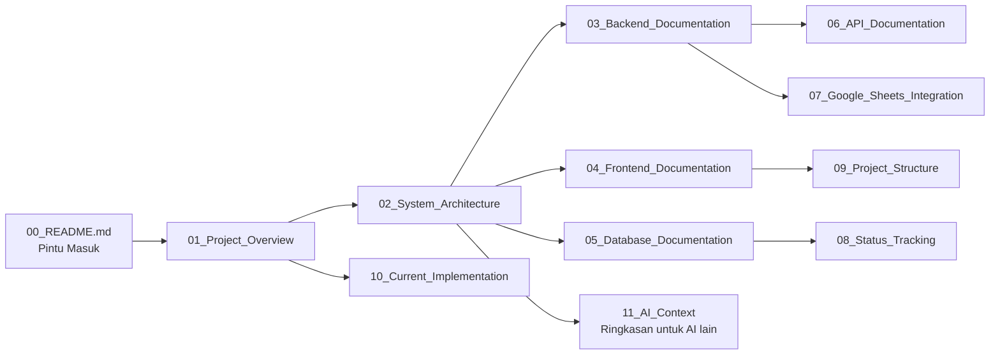

# Dokumentasi Sistem Tracking Sampel Lab KTNT UNPAD

Dokumen ini adalah pintu masuk untuk memahami keseluruhan sistem **Sistem Tracking Sampel Laboratorium Kimia Tanah dan Nutrisi Tanaman (Lab KTNT) Fakultas Pertanian Universitas Padjadjaran**.

Sistem ini dikembangkan untuk memberikan transparansi proses pengujian sampel kepada pelanggan melalui website, dengan integrasi Google Sheets, Google Drive, Email, dan WhatsApp.

---

## Daftar Dokumen dan Urutan Membaca

Berikut daftar seluruh dokumen beserta urutan yang disarankan. Disarankan membaca secara berurutan untuk membangun pemahaman dari gambaran umum hingga detail implementasi.

| Urutan | File | Isi | Untuk Siapa |
|--------|------|-----|-------------|
| 1 | `01_Project_Overview.md` | Tujuan project, masalah yang diselesaikan, aktor, fitur utama, workflow umum, ruang lingkup | Developer baru & non-teknis |
| 2 | `02_System_Architecture.md` | Arsitektur keseluruhan: frontend, backend, database, Google Sheets, Google Drive, Email, WhatsApp, alur komunikasi antar komponen (dengan diagram Mermaid) | Developer & arsitek |
| 3 | `03_Backend_Documentation.md` | Analisis backend: struktur folder, controller, routes, services, middleware, cron job, flow request, flow sinkronisasi | Developer backend |
| 4 | `04_Frontend_Documentation.md` | Analisis frontend: struktur folder, halaman, komponen, routing, state management, flow user | Developer frontend |
| 5 | `05_Database_Documentation.md` | Seluruh tabel, fungsi, relasi, primary/foreign key, lifecycle data, ERD Mermaid | Developer & DBA |
| 6 | `06_API_Documentation.md` | Dokumentasi seluruh endpoint: method, URL, tujuan, request, response, halaman pengguna | Developer & AI |
| 7 | `07_Google_Sheets_Integration.md` | Struktur sheet, fungsi tiap sheet, sinkronisasi, trigger, cron, hubungan dengan database | Developer & admin lab |
| 8 | `08_Status_Tracking.md` | Lifecycle seluruh status tracking, siapa yang mengubah, trigger, notifikasi, kondisi selesai, diagram Mermaid | Semua |
| 9 | `09_Project_Structure.md` | Struktur project: folder penting, folder dependency, folder yang boleh/dilarang diubah | Developer baru |
| 10 | `10_Current_Implementation.md` | Kondisi project saat ini: fitur selesai, belum selesai, known issues, technical debt, TODO | Developer & pemilik project |
| 11 | `11_AI_Context.md` | Ringkasan tunggal agar AI lain (Claude, ChatGPT, Gemini, Kimi, dll.) memahami project hanya dengan satu file | AI & developer |

---

## Bagan Urutan Membaca

> **Catatan untuk AI**: Jika Anda adalah AI yang baru pertama kali diminta membantu project ini dan hanya bisa membaca satu file, baca `11_AI_Context.md`. Jika Anda akan mengubah kode, baca juga `09_Project_Structure.md` dan dokumen teknis yang relevan.

---

## Ringkasan Singkat

- **Jenis**: Website pelacakan status pengujian sampel laboratorium + integrasi otomatis dengan Google Sheets.
- **Frontend**: React + Vite + Tailwind CSS (`frontend/`).
- **Backend**: Node.js + Express 5 + MySQL (`backend/`).
- **Integrasi eksternal**: Google Sheets API, Google Drive API, SMTP Email (Gmail), WhatsApp API (Fonnte).
- **Sinkronisasi**: Cron job backend membaca perubahan dari Google Sheets setiap 30 detik.
- **Sifat project**: **Belum production-ready**. Admin mengoperasikan data di Google Sheets, sebagian endpoint dikonsumsi oleh frontend, sebagian lainnya masih memerlukan admin panel yang belum ada.
