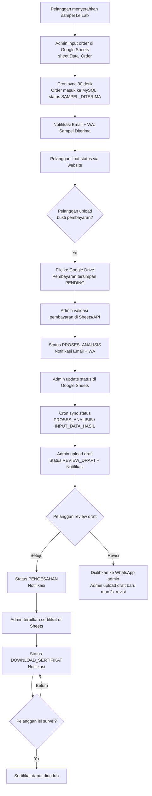

# 01. Project Overview

## Tujuan Project

Project **Sistem Tracking Sampel Lab KTNT UNPAD** dibuat untuk memungkinkan pelanggan Laboratorium Kimia Tanah dan Nutrisi Tanaman (Lab KTNT) Fakultas Pertanian Universitas Padjadjaran memantau **status pengujian sampel** mereka secara *real-time* dan transparan melalui website.

Sebelumnya, pelanggan harus menghubungi admin laboratorium (telepon/WhatsApp) untuk menanyakan perkembangan proses pengujian sampel yang telah mereka serahkan. Sistem ini menggantikan proses tersebut dengan website tracking yang dapat diakses publik.

## Masalah yang Diselesaikan

1. **Kurangnya transparansi proses** — Pelanggan tidak mengetahui di tahap mana sampel mereka sedang diproses.
2. **Beban komunikasi admin** — Admin harus berulang kali menjawab pertanyaan status via telepon/WhatsApp.
3. **Tidak ada notifikasi otomatis** — Pelanggan tidak diberitahu saat status sampel berubah (pembayaran terverifikasi, draft siap, sertifikat terbit).
4. **Distribusi dokumen manual** — Invoice, draft hasil, dan sertifikat harus dikirim manual; kini diakses lewat satu link tracking.
5. **Feedback pelanggan tidak terstruktur** — Belum ada mekanisme survei kepuasan yang terdokumentasi.

## Aktor Sistem

| Aktor | Deskripsi | Interaksi utama |
|-------|-----------|-----------------|
| **Pelanggan / Customer** | Pihak eksternal (perusahaan/perorangan) yang menitipkan sampel | Melihat status, upload bukti pembayaran, review & menyetujui draft, mengajukan revisi, mengisi survei, mengunduh sertifikat |
| **Admin Laboratorium** | Staf Lab KTNT yang mengelola pesanan dan proses | Input order di Google Sheets, update status di Google Sheets, validasi pembayaran, upload draft (via API) |
| **Sistem (Otomatis)** | Backend yang menjalankan sinkronisasi dan notifikasi | Cron job sync Google Sheets → MySQL, kirim notifikasi Email & WhatsApp |

> **Catatan**: Admin **tidak memiliki aplikasi/admin panel khusus**. Admin beroperasi langsung pada **Google Sheets** (master data) dan sebagian melalui **API backend**. Kondisi ini dijelaskan lebih lanjut di `10_Current_Implementation.md`.

## Fitur Utama

### Sudah Terimplementasi

1. **Tracking status sampel** — Pelanggan memasukkan kode tracking untuk melihat posisi sampel, riwayat status, estimasi selesai, dan SLA.
2. **Estimasi waktu pengerjaan (SLA)** — Perhitungan otomatis sisa hari berdasarkan `tanggal_masuk + estimasi_hari`, dengan label *"X Hari Lagi"*, *"Estimasi Selesai Hari Ini"*, atau *"Terlambat X Hari"*.
3. **Upload bukti pembayaran** — Pelanggan mengunggah bukti transfer (JPG/PNG/PDF, maks 5MB); file disimpan di Google Drive.
4. **Download invoice** — Link invoice ditampilkan di halaman status untuk diunduh pelanggan.
5. **Review draft** — Pelanggan dapat melihat draft hasil pengujian, **menyetujui** (lanjut pengesahan) atau **mengajukan revisi** (dialihkan ke WhatsApp admin).
6. **Survei kepuasan** — Kuesioner 6 pertanyaan rating (1–5) + saran; wajib diisi sebelum sertifikat dapat diunduh.
7. **Download sertifikat** — Sertifikat Hasil Uji (SHU) dalam bentuk PDF/link Google Drive.
8. **Notifikasi otomatis** — Email dan WhatsApp terkirim pada tiap perubahan status kunci.
9. **Sinkronisasi Google Sheets → MySQL** — Order, status, pembayaran, draft, dan sertifikat otomatis tersinkronisasi tiap 30 detik.
10. **Landing page informatif** — Halaman beranda berisi layanan, alur proses, dan kontak Lab KTNT.

### Belum Terimplementasi

- **Admin panel / dashboard admin** di frontend (seluruh operasi admin masih berbasis Google Sheets dan API mentah).
- **Autentikasi & otorisasi** (tidak ada login; kode tracking adalah satu-satunya "kunci" akses).
- **Upload invoice/draft/sertifikat dari frontend** (endpoint upload draft ada, tetapi tidak ada UI admin).
- **Validasi pembayaran dari UI** (endpoint ada, tetapi tidak ada UI admin).

## Workflow Secara Umum

## Ruang Lingkup Project

### Di Luar Ruang Lingkup (In Scope)

1. Website publik (landing page, tracking, survey).
2. Backend REST API.
3. Sinkronisasi data dengan Google Sheets.
4. Penyimpanan file di Google Drive.
5. Notifikasi email dan WhatsApp.
6. Manajemen data: order, customer, payment, draft, sertifikat, tracking log, kuesioner, notifikasi.

### Di Luar Ruang Lingkup (Out of Scope / Bukan Bagian)

1. Proses analisis kimia/fisika/biologi di laboratorium itu sendiri (di luar sistem).
2. Sistem pembayaran otomatis (gateway/midtrans, dll.) — pembayaran dilakukan manual transfer bank.
3. Autentikasi pengguna dan sistem admin penuh.
4. Modul inventaris sampel fisik / penjadwalan alat lab.
5. Integrasi dengan sistem akademik/kemahasiswaan UNPAD.

## Teknologi Utama

| Komponen | Teknologi |
|----------|-----------|
| Frontend | React 18, Vite, Tailwind CSS 3, Framer Motion, lucide-react, Axios |
| Backend | Node.js, Express 5, MySQL (mysql2/promise) |
| Integrasi | Google Sheets API v4, Google Drive API v3, Nodemailer (SMTP), WhatsApp API (Fonnte) |
| Otomatisasi | node-cron (sinkronisasi setiap 30 detik) |
| Keamanan dasar | express-rate-limit, CORS allowlist, validasi kode tracking |

> Detail teknologi lengkap ada di `02_System_Architecture.md`.

## Istilah Penting

| Istilah | Arti |
|---------|------|
| **Kode Tracking** | Identitas unik sebuah order (contoh: `LAB-2026-0001`) yang digunakan pelanggan untuk melacak sampel |
| **SHU** | Sertifikat Hasil Uji — dokumen final hasil pengujian |
| **Draft** | Dokumen hasil pengujian sementara yang harus direview dan disetujui pelanggan (maks 2 kali revisi / 3 versi) |
| **Cron Sync** | Proses otomatis backend membaca Google Sheets dan menyalin perubahannya ke MySQL tiap 30 detik |
| **SLA** | Estimasi jumlah hari penyelesaian yang dijanjikan sejak sampel diterima |
