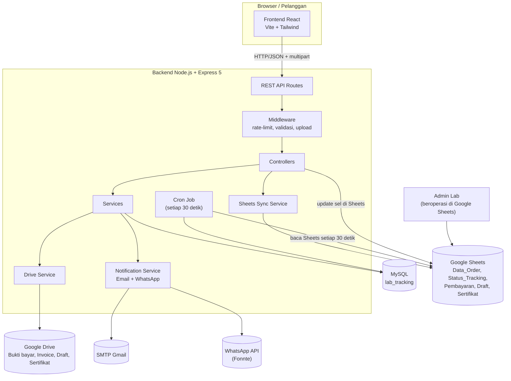
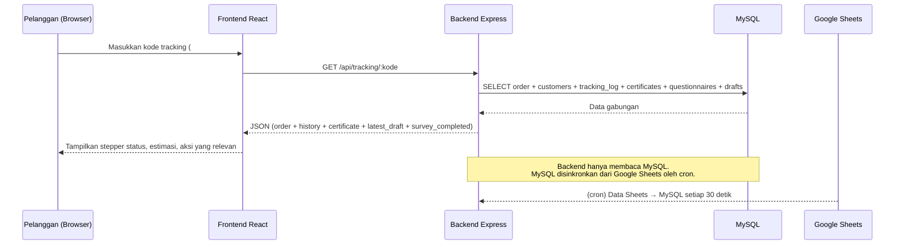
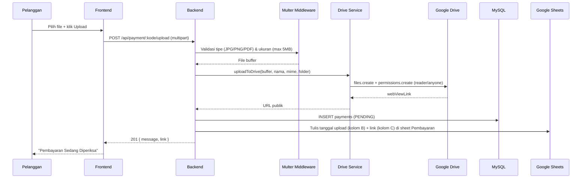
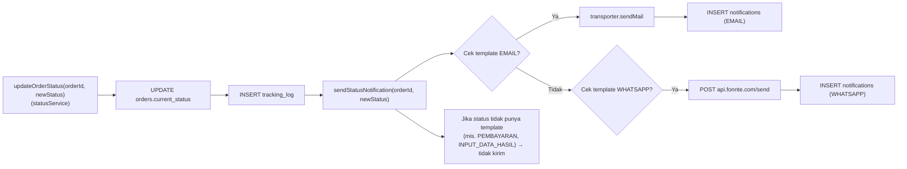
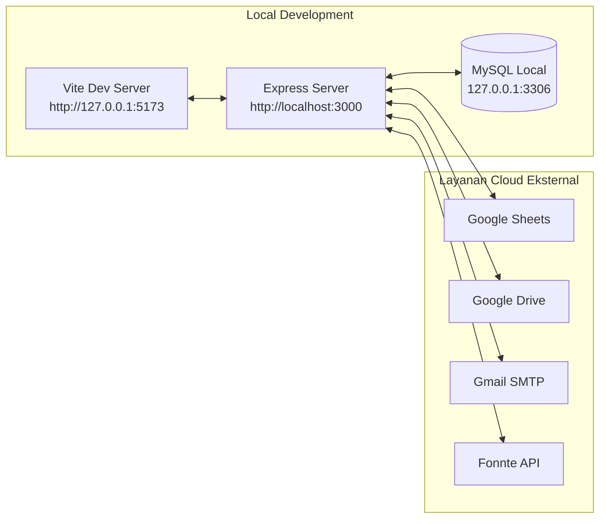

# 02. System Architecture

## Gambaran Umum

Sistem Tracking Sampel Lab KTNT UNPAD terdiri dari **dua aplikasi utama** (frontend React dan backend Express) yang dihubungkan melalui **REST API**, serta empat layanan eksternal: **MySQL**, **Google Sheets**, **Google Drive**, **SMTP Email**, dan **WhatsApp API**.

Pola arsitektur yang digunakan adalah **client–server** dengan **sinkronisasi pull berkala** dari Google Sheets ke MySQL oleh cron job backend. Google Sheets berperan sebagai **sumber data operasional admin** ("master untuk admin"), sedangkan MySQL adalah **sumber data untuk API/frontend**.

---

## Komponen Arsitektur

### 1. Frontend (React SPA)

- **Lokasi**: `frontend/`
- **Teknologi**: React 18, Vite, Tailwind CSS 3, Framer Motion, lucide-react, Axios.
- **Peran**: Menampilkan landing page, form pencarian tracking, halaman status sampel, dan formulir survei.
- **Routing**: Menggunakan **hash routing** (hook `useHashRoute`) — bukan React Router. URL berbentuk `#lacak-sampel`, `#status?kode=LAB-...`, `#pengisian-survey?kode=...`.
- **State management**: Hanya `useState`/`useEffect` lokal per halaman; **tidak ada** global store (Redux/Zustand).
- **Komunikasi**: Axios ke backend melalui variabel `VITE_API_URL` (default `http://localhost:3000/api`).

Detail lengkap: `04_Frontend_Documentation.md`.

### 2. Backend (REST API)

- **Lokasi**: `backend/`
- **Teknologi**: Node.js, Express 5, `mysql2/promise`, `googleapis`, `nodemailer`, `node-cron`, `multer`, `express-rate-limit`, `cors`, `dotenv`.
- **Peran**:
  1. Melayani request dari frontend (tracking, payment, draft, questionnaire, health).
  2. Menjalankan cron sinkronisasi Google Sheets → MySQL.
  3. Mengunggah file ke Google Drive.
  4. Mengirim notifikasi email & WhatsApp.
- **Entry point**: `backend/server.js`.

Detail lengkap: `03_Backend_Documentation.md` dan `06_API_Documentation.md`.

### 3. Database MySQL

- **Nama database**: `lab_tracking` (dari variabel `DB_NAME`).
- **Peran**: Penyimpanan utama data terstruktur yang melayani API/frontend.
- **8 tabel**: `customers`, `orders`, `tracking_log`, `payments`, `drafts`, `certificates`, `questionnaires`, `notifications`.

Detail lengkap: `05_Database_Documentation.md`.

### 4. Google Sheets

- **Peran**: **Master data operasional admin**. Admin mengelola order, status, dan dokumen langsung di Google Sheets.
- **Spreadsheet** diakses dengan **Service Account** (`credentials/service-account.json`) via Google Sheets API v4.
- **5 tab (sheet)** yang digunakan:
  - `Data_Order` — data order baru (sumber pembuatan order di MySQL).
  - `Status_Tracking` — perubahan status manual oleh admin.
  - `Pembayaran` — data bukti pembayaran & validasi.
  - `Draft` — data draft hasil pengujian & persetujuan.
  - `Sertifikat` — data sertifikat final.
- **Arah data**:
  - **Sheets → MySQL**: dibuat oleh cron sync (order baru, status manual, validasi pembayaran, draft upload, persetujuan draft, sertifikat).
  - **MySQL/API → Sheets**: backend menulis balik ke Sheets (tanggal upload bukti bayar & link di sheet `Pembayaran`; tanggal persetujuan di sheet `Draft`).

Detail lengkap: `07_Google_Sheets_Integration.md`.

### 5. Google Drive

- **Peran**: Menyimpan file bukti pembayaran yang diunggah pelanggan, serta menjadi lokasi file invoice, draft, dan sertifikat (dalam bentuk link publik).
- **Metode akses**: Google Drive API v3 dengan **OAuth2 refresh token** (berbeda dengan Sheets yang memakai Service Account).
- **Folder** (dikonfigurasi di `.env`):
  - `GOOGLE_DRIVE_FOLDER_BUKTI_PEMBAYARAN`
  - `GOOGLE_DRIVE_FOLDER_INVOICE`
  - `GOOGLE_DRIVE_FOLDER_DRAFT`
  - `GOOGLE_DRIVE_FOLDER_SERTIFIKAT`
- **Perilaku**: Setiap file yang diunggah otomatis diberi izin `reader` untuk **anyone** (link dapat diakses publik tanpa login), dan link `webViewLink` disimpan ke database/Sheets.
- Saat ini kode **hanya menggunakan** folder bukti pembayaran (melalui `uploadToDrive`). Folder invoice/draft/sertifikat belum dipakai langsung oleh kode backend (link-nya dimasukkan admin manual ke Sheets).

### 6. Email (SMTP Gmail)

- **Library**: Nodemailer, konfigurasi di `src/config/mailer.js`.
- **Server**: `smtp.gmail.com:587` (TLS), kredensial di `.env` (`SMTP_USER`, `SMTP_PASS`).
- **Peran**: Mengirim email notifikasi perubahan status kepada pelanggan.
- **Template**: `SAMPEL_DITERIMA`, `PROSES_ANALISIS`, `REVIEW_DRAFT`, `PENGESAHAN`, `DOWNLOAD_SERTIFIKAT`.
- **Pencatatan**: Status kirim (SENT/FAILED) disimpan di tabel `notifications`.

### 7. WhatsApp (Fonnte API)

- **Provider**: Fonnte (`https://api.fonnte.com/send`), token di `.env` (`WHATSAPP_API_URL`, `WHATSAPP_API_TOKEN`).
- **Peran**: Mengirim pesan WhatsApp notifikasi perubahan status.
- **Pencatatan**: Status kirim disimpan di tabel `notifications` dengan channel `WHATSAPP`.

---

## Alur Komunikasi Antar Komponen

### A. Alur Pelanggan Melihat Status (Request–Response)

### B. Alur Upload Bukti Pembayaran

### C. Alur Notifikasi Status

---

## Pola Penting Arsitektur

1. **Google Sheets sebagai sumber kebenaran admin, MySQL sebagai sumber kebenaran runtime.**
   - Admin → Google Sheets.
   - Cron → salin ke MySQL.
   - API/Frontend → baca MySQL.
   - Beberapa aksi pelanggan (upload bukti bayar, approve draft) menulis **MySQL dan Sheets sekaligus**.

2. **Sinkronisasi satu arah dominan (Sheets → MySQL).** Cron berjalan setiap **30 detik** (`*/30 * * * * *`). Tidak ada mekanisme inverse (MySQL → Sheets) yang menyeluruh; hanya penulisan sel-sel tertentu oleh API.

3. **Dua metode autentikasi Google yang berbeda:**
   - **Service Account** untuk Google Sheets (`src/config/sheets.js`).
   - **OAuth2 + refresh token** untuk Google Drive (`src/services/driveService.js`).

4. **Kode tracking adalah satu-satunya "kredensial" pelanggan.** Tidak ada login; siapa pun yang mengetahui kode dapat mengakses status dan mengirim aksi. Ini risiko keamanan yang perlu diperhatikan (lihat `10_Current_Implementation.md`).

5. **Tidak ada message broker / antrean.** Notifikasi dikirim secara sinkron di dalam alur request maupun cron.

---

## Diagram Deployment Konseptual

> **Catatan**: Saat ini backend hanya dikonfigurasi untuk dijalankan lokal (`.env` mengarah ke `127.0.0.1`). Belum ada konfigurasi deployment produksi (Docker, PM2, VPS, dll.) — lihat `10_Current_Implementation.md`.
