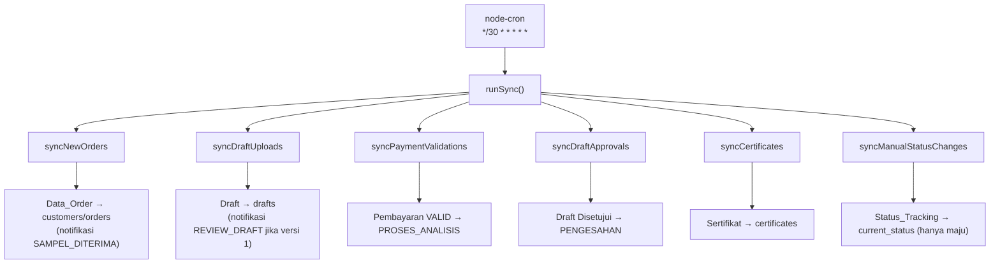
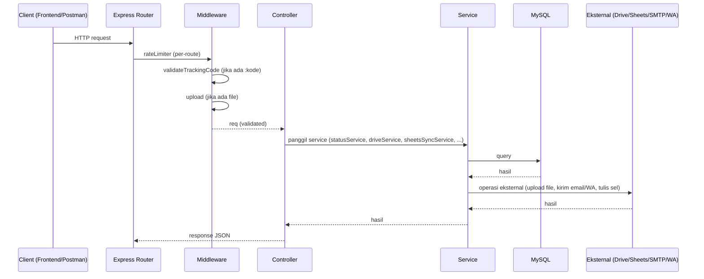
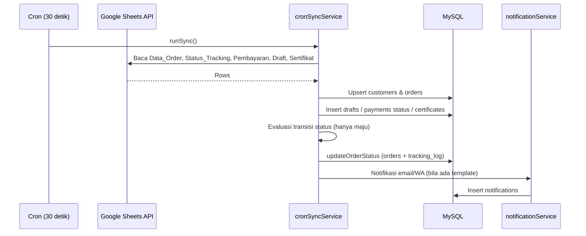

# 03. Backend Documentation

## Ringkasan

Backend adalah aplikasi **Node.js + Express 5** (CommonJS) yang berfungsi sebagai:

1. **REST API** untuk frontend (tracking, pembayaran, draft, kuesioner).
2. **Cron job sinkronisasi** Google Sheets → MySQL setiap 30 detik.
3. **Integrator eksternal**: Google Drive (upload file), SMTP (email), Fonnte (WhatsApp).

Entry point: `backend/server.js`.

## Struktur Folder

```
backend/
├── server.js                          # Entry point: init express, CORS, routes, error handler, cron, listen
├── .env                               # Konfigurasi lingkungan (TIDAK boleh di-commit)
├── .env.example                       # Contoh variabel (tidak lengkap — hanya ADMIN_WA_NUMBER)
├── package.json
├── credentials/
│   └── service-account.json           # Kredensial Google Service Account untuk Sheets (JANGAN di-commit)
└── src/
    ├── config/
    │   ├── db.js                      # Koneksi pool MySQL
    │   ├── mailer.js                  # Transporter Nodemailer (SMTP Gmail)
    │   └── sheets.js                  # Klien Google Sheets API + SPREADSHEET_ID
    ├── controllers/
    │   ├── trackingController.js      # GET status tracking
    │   ├── paymentController.js       # Upload & validasi bukti pembayaran
    │   ├── draftController.js         # Upload draft, approve, revisi
    │   └── questionnaireController.js # Submit kuesioner
    ├── middleware/
    │   ├── rateLimiter.js             # Pembatasan request (general & tracking)
    │   ├── upload.js                  # Multer memory storage (max 5MB, JPG/PNG/PDF)
    │   └── validateTrackingCode.js    # Validasi format kode tracking
    ├── routes/
    │   ├── trackingRoutes.js          # GET /:kode_tracking
    │   ├── paymentRoutes.js           # POST upload, PATCH validate
    │   ├── draftRoutes.js             # POST upload/approve/revisi
    │   └── questionnaireRoutes.js     # POST /:kode_tracking
    └── services/
        ├── statusService.js           # updateOrderStatus (update + log + notifikasi)
        ├── notificationService.js     # Email & WhatsApp templates + pengiriman
        ├── driveService.js            # Upload file ke Google Drive + izin publik
        ├── sheetsSyncService.js       # Baca/tulis sel di Google Sheets
        └── cronSyncService.js         # Sinkronisasi 6 modul Sheets → MySQL
```

---

## Entry Point — `server.js`

| Aspek | Detail |
|-------|--------|
| **Middleware global** | `cors` (allowlist dari `ALLOWED_ORIGIN`), `express.json()`, `generalLimiter` |
| **Route mount** | `/api/draft`, `/api/tracking` (dengan `trackingLimiter`), `/api/payment`, `/api/questionnaire` |
| **Health check** | `GET /health` → `{ status: 'ok', message: 'Backend Lab Tracking jalan!' }` |
| **Error handler** | Menangkap `LIMIT_FILE_SIZE` → 413; error lain → 500 dengan pesan generik |
| **Startup** | `testConnection()` dulu, lalu `cron.schedule('*/30 * * * * *', runSync)`, lalu `app.listen(PORT)` |
| **CORS** | Origin diizinkan hanya jika ada di daftar `ALLOWED_ORIGIN` (dipisah koma). Jika tanpa origin (non-browser), diizinkan |

> **Catatan penting**: Jika koneksi MySQL gagal saat `testConnection()`, server tetap berjalan (hanya log error). Tidak ada mekanisme retry khusus.

---

## Config

### `src/config/db.js`

- Membuat **pool koneksi MySQL** (`mysql2/promise`) dengan `connectionLimit: 10`.
- Konfigurasi dari env: `DB_HOST`, `DB_PORT`, `DB_USER`, `DB_PASSWORD`, `DB_NAME`.
- Ekspor: `{ pool, testConnection }`.
- `testConnection()` mengambil 1 koneksi, `ping()`, lalu melepasnya. Log berhasil/gagal ke konsol.

### `src/config/mailer.js`

- Membuat transporter Nodemailer dengan `host`, `port`, `secure: false` (port 587), `auth.user`/`auth.pass`.
- Ekspor: `{ transporter }`.

### `src/config/sheets.js`

- Membuat klien `GoogleAuth` dengan **Service Account** (`keyFile` dari env `GOOGLE_SERVICE_ACCOUNT_PATH`).
- Scope: `spreadsheets` + `drive`.
- Ekspor: `{ sheets, SPREADSHEET_ID }` (dari env `GOOGLE_SHEETS_ID`).

---

## Middleware

### `src/middleware/rateLimiter.js`

- `generalLimiter`: **100 request / 60 detik** — dipasang global di `server.js`.
- `trackingLimiter`: **30 request / 60 detik** — dipasang pada route `/api/tracking`.
- Response saat limit: `429` dengan `{ message: 'Terlalu banyak request, coba lagi nanti.' }`.

### `src/middleware/upload.js`

- Multer **memoryStorage** — file disimpan di memori, bukan disk (langsung diteruskan ke Google Drive).
- Limit: maksimal **5 MB** (`5 * 1024 * 1024`).
- Filter tipe: hanya `image/jpeg`, `image/png`, `application/pdf`. Lainnya → error `'Tipe file tidak didukung...'`.
- Ekspor: `{ upload }`.

### `src/middleware/validateTrackingCode.js`

- Regex: `^[A-Za-z0-9_-]+$`.
- Jika `kode_tracking` di params tidak cocok → `400 { message: 'Format kode tracking tidak valid.' }`.
- Dipasang di semua route yang memakai `:kode_tracking`.

---

## Controllers

### `src/controllers/trackingController.js`

**Fungsi**: `getTrackingStatus(req, res)` — endpoint `GET /api/tracking/:kode_tracking`.

Alur:
1. Cari `orders` join `customers` berdasarkan `kode_tracking`.
2. Jika tidak ada → `404 { message: 'Kode tracking tidak ditemukan.' }`.
3. Hitung estimasi/SLA via fungsi lokal `hitungEstimasi(tanggalMasuk, estimasiHari)`:
   - `targetSelesai = tanggal_masuk + estimasi_hari` (hari).
   - Hitung `sisa_hari` dibandingkan hari ini.
   - Label: `"X Hari Lagi"` / `"Estimasi Selesai Hari Ini"` / `"Terlambat X Hari"`.
   - Mengembalikan `tanggal_estimasi_selesai`, `sisa_hari`, `label`.
4. Ambil riwayat dari `tracking_log` (urut ascending `created_at`).
5. Ambil sertifikat terbaru dari `certificates`.
6. Cek apakah kuesioner sudah diisi (`questionnaires`).
7. Ambil draft terbaru (`drafts` versi tertinggi).
8. Gabungkan dalam satu JSON:
   ```json
   {
     "order": { "...fields", "estimasi": {...} },
     "history": [...],
     "certificate": {...} | null,
     "latest_draft": {...} | null,
     "survey_completed": true/false
   }
   ```

### `src/controllers/questionnaireController.js`

**Fungsi**: `submitQuestionnaire(req, res)` — endpoint `POST /api/questionnaire/:kode_tracking`.

Alur:
1. Baca `q1..q6` dan `saran` dari body.
2. Validasi: semua `q1..q6` wajib, harus integer 1–5. Gagal → `400`.
3. Cari `order_id` berdasarkan kode tracking. Tidak ada → `404`.
4. `INSERT` ke tabel `questionnaires` dengan `submitted_at = NOW()`.
5. Sukses → `201 { message: 'Survei berhasil dikirim.' }`.

> Catatan: Tidak ada pembatasan pengisian berulang — pelanggan dapat mengirim kuesioner lebih dari satu kali untuk order yang sama.

### `src/controllers/paymentController.js`

**Fungsi 1**: `uploadPaymentProof(req, res)` — `POST /api/payment/:kode_tracking/upload` (multipart, field `bukti_pembayaran`).

1. Jika tidak ada `req.file` → `400 'File bukti pembayaran wajib diupload.'`.
2. Cari `order_id`. Tidak ada → `404`.
3. Buat nama file aman: `kode_tracking_timestamp_safeOriginalName` (karakter non-alphanumeric diganti `_`, max 100 char).
4. `uploadToDrive(buffer, fileName, mimeType, GOOGLE_DRIVE_FOLDER_BUKTI_PEMBAYARAN)` → URL publik.
5. `INSERT` ke `payments` dengan `status_validasi = 'PENDING'`, `tanggal_upload_bukti = NOW()`.
6. **Tulis balik ke Sheets**: cari baris di sheet `Pembayaran` → tulis tanggal (kolom B) dan link (kolom C).
7. Sukses → `201 { message, link }`.

**Fungsi 2**: `validatePayment(req, res)` — `PATCH /api/payment/:kode_tracking/validate`.

1. Validasi `status_validasi` harus `VALID` atau `INVALID` → selain itu `400`.
2. Cari `order_id`. Tidak ada → `404`.
3. `UPDATE payments SET status_validasi, tanggal_validasi = NOW()` pada payment terbaru (`ORDER BY payment_id DESC LIMIT 1`).
4. Jika `VALID` → `updateOrderStatus(orderId, 'PROSES_ANALISIS', 'Pembayaran divalidasi admin', 'ADMIN_MANUAL')`.
5. Sukses → `200 { message: 'Pembayaran ditandai VALID/INVALID.' }`.

> Catatan: Endpoint ini ditujukan untuk admin tetapi **tidak memiliki autentikasi** — siapa pun yang tahu kode tracking dapat memanggilnya.

### `src/controllers/draftController.js`

**Konstanta**: `MAX_VERSI_DRAFT = 3` (versi 1 = draft awal, versi 2 & 3 = maksimal 2 kali revisi).

**Fungsi 1**: `uploadDraft(req, res)` — `POST /api/draft/:kode_tracking/upload` (admin).

1. Wajib `link_draft` berupa URL valid → selain itu `400`.
2. Cari `order_id`. Tidak ada → `404`.
3. Hitung versi baru = versi tertinggi + 1 (atau 1 jika belum ada).
4. Jika versi baru > 3 → `400 'Batas maksimal 2 kali revisi sudah tercapai.'`.
5. `INSERT` ke `drafts` dengan `status_draft = 'MENUNGGU_REVIEW'`.
6. Jika versi 1 → `updateOrderStatus(orderId, 'REVIEW_DRAFT', ...)` (order pindah ke review).
7. Sukses → `201 { message: 'Draft versi N berhasil diupload.' }`.

> Catatan: Tidak ada autentikasi — endpoint ini seharusnya hanya dipanggil admin.

**Fungsi 2**: `approveDraft(req, res)` — `POST /api/draft/:kode_tracking/approve` (pelanggan).

1. Cari `order_id`. Tidak ada → `404`.
2. `UPDATE drafts SET status_draft = 'DISETUJUI'` pada draft terbaru.
3. **Tulis balik ke Sheets**: kolom F sheet `Draft` diisi tanggal persetujuan (format `id-ID`, misal `6 Agustus 2026`).
4. Sukses → `200 { message: 'Persetujuan Anda telah dikirim, menunggu verifikasi admin.' }`.

> Catatan: `approveDraft` **tidak** langsung mengubah `orders.current_status`. Perubahan ke `PENGESAHAN` terjadi lewat cron `syncDraftApprovals` ketika kolom status draft di sheet `Draft` bernilai `Disetujui`. Ini adalah pola "dua langkah" yang penting dipahami.

**Fungsi 3**: `requestRevision(req, res)` — `POST /api/draft/:kode_tracking/revisi` (pelanggan).

1. Cari `order_id`. Tidak ada → `404`.
2. Jika versi draft terbaru sudah ≥ 3 → `400 'Batas maksimal 2 kali revisi sudah tercapai.'`.
3. `UPDATE drafts SET status_draft = 'REVISI'` pada draft terbaru.
4. **Tulis balik ke Sheets**: kolom E sheet `Draft` diisi `'Revisi'`.
5. Buat URL WhatsApp ke admin: `https://wa.me/<ADMIN_WA_NUMBER>?text=Revisi draft untuk kode tracking <kode>`.
6. Sukses → `200 { message, whatsapp_url }`. Frontend membuka URL ini di tab baru.

---

## Services

### `src/services/statusService.js`

**Fungsi**: `updateOrderStatus(orderId, newStatus, keterangan, source = 'ADMIN_MANUAL')`.

Merupakan **titik tunggal perubahan status** yang melakukan 3 hal secara berurutan:
1. `UPDATE orders SET current_status = newStatus`.
2. `INSERT tracking_log (order_id, status, keterangan_status, source)`.
3. `sendStatusNotification(orderId, newStatus)` — kirim email/WA bila ada template.

Nilai `source` yang dipakai di codebase: `ADMIN_MANUAL` dan `AUTO_SCRIPT`.

### `src/services/notificationService.js`

**Fungsi**: `sendStatusNotification(orderId, newStatus)` dan pembantu `sendWhatsApp`.

- `EMAIL_TEMPLATES` & `WHATSAPP_TEMPLATES`: kumpulan template per status (`SAMPEL_DITERIMA`, `PROSES_ANALISIS`, `REVIEW_DRAFT`, `PENGESAHAN`, `DOWNLOAD_SERTIFIKAT`).
- Alur:
  1. Jika tidak ada template untuk status → return (tidak kirim apa pun). Status tanpa template: `PEMBAYARAN`, `INPUT_DATA_HASIL`.
  2. Ambil data `kode_tracking`, `nama_perusahaan`, `email`, `no_hp` dari order+customer.
  3. **Email**: `transporter.sendMail` dari `"Lab KTNT UNPAD" <SMTP_USER>` → `order.email`. Status `SENT`/`FAILED`.
  4. **WhatsApp**: `fetch(WHATSAPP_API_URL)` dengan method POST, `Authorization: WHATSAPP_API_TOKEN`, body form-urlencoded `{ target: no_hp, message }`. Jika `response.ok` false atau `data.status === false` → throw. Status `SENT`/`FAILED`.
  5. Setiap percobaan di-`INSERT` ke `notifications (order_id, channel, template, sent_at, status)`.

### `src/services/driveService.js`

**Fungsi**: `uploadToDrive(fileBuffer, fileName, mimeType, folderId)`.

- Menggunakan **OAuth2Client** (bukan Service Account) dengan `GOOGLE_OAUTH_CLIENT_ID`, `GOOGLE_OAUTH_CLIENT_SECRET`, `GOOGLE_OAUTH_REFRESH_TOKEN`.
- `drive.files.create` → menyimpan ke folder `folderId`, dengan `media.body = Readable.from(fileBuffer)`.
- Setelah upload: `drive.permissions.create` dengan `role: 'reader', type: 'anyone'` → **file dapat diakses publik tanpa login**.
- Mengembalikan `webViewLink` (URL publik).

### `src/services/sheetsSyncService.js`

Berisi dua helper untuk operasi sel di Google Sheets:

- `findRowByKodeTracking(sheetName, kodeTracking, headerRow = 1)`:
  - Baca `{sheetName}!A2:Z1000`.
  - Cari baris yang nilai kolom A-nya sama dengan `kodeTracking`.
  - Kembalikan `{ rowNumber, rowData }` atau `null` jika tidak ditemukan.
- `updateCell(sheetName, rowNumber, columnLetter, value)`:
  - Tulis satu nilai ke sel `{sheetName}!{column}{row}` dengan `valueInputOption: 'USER_ENTERED'`.

### `src/services/cronSyncService.js`

Fungsi utama sinkronisasi Sheets → MySQL. Dipanggil oleh cron setiap **30 detik**.

**Fungsi**: `runSync()` — menjalankan 6 sinkronisasi berurutan:

```js
await syncNewOrders();
await syncDraftUploads();
await syncPaymentValidations();
await syncDraftApprovals();
await syncCertificates();
await syncManualStatusChanges();
```

Urutan ini penting: order harus ada dulu sebelum draft/payment/certificate/status diproses.

#### `syncNewOrders()` — sheet `Data_Order!A2:J1000`

- Kolom: A=kode_tracking, B=tanggal_masuk, C=nama_perusahaan, D=jenis_analisis_sampel, E=no_hp, F=email, G=estimasi_hari, H=kode_invoice, I=harga_total, J=link_invoice.
- Lewati baris tanpa kode tracking, tanpa nama perusahaan, atau tanpa email.
- Parsing: `estimasi_hari` diambil digitnya saja; `harga_total` diambil angka/desimalnya saja.
- **Upsert customer** berdasarkan email:
  - Sudah ada → update `nama_perusahaan`, `no_hp`.
  - Belum → insert.
- **Upsert order** berdasarkan kode tracking:
  - Sudah ada → update field order (tanpa mengubah `current_status`).
  - Belum → insert dengan `current_status = 'SAMPEL_DITERIMA'` lalu `updateOrderStatus(orderId, 'SAMPEL_DITERIMA', 'Order baru terdeteksi dari Google Sheets', 'AUTO_SCRIPT')` → memicu log + notifikasi email/WA "Sampel Diterima".

#### `syncManualStatusChanges()` — sheet `Status_Tracking!A2:E1000`

- Kolom: A=kode_tracking, B=status_label, C=keterangan, (D, E tidak dibaca kode).
- Map label Sheets → enum: `Sampel Diterima`, `Pembayaran`, `Proses Analisis`, `Input Data Hasil`, `Review Draft`, `Pengesahan`, `Download Sertifikat`.
- Label tidak dikenali → dilewati.
- **Hanya boleh maju**: status baru diterapkan hanya jika indeksnya lebih besar dari `current_status` di `STATUS_ORDER`. Tidak pernah mundur.
- Jika maju → `updateOrderStatus(orderId, sheetStatus, keterangan, 'AUTO_SCRIPT')`.

#### `syncPaymentValidations()` — sheet `Pembayaran!A2:H1000`

- Kolom: A=kode_tracking, D=status_validasi (`row[3]`).
- Hanya proses baris dengan status `'VALID'`.
- Jika order saat ini `PEMBAYARAN` → `updateOrderStatus(orderId, 'PROSES_ANALISIS', 'Pembayaran divalidasi admin via Sheets', 'AUTO_SCRIPT')`.

#### `syncDraftUploads()` — sheet `Draft!A2:F1000`

- Kolom: A=kode_tracking, B=versi_draft, C=link_draft, D=tanggal_upload, E=status_draft, F=disetujui_customer.
- Validasi: versi harus 1–3, link harus ada, tanggal harus parse-able.
- Normalisasi status draft (`MENUNGGU_REVIEW`, `DISETUJUI`, `REVISI`); selain itu fallback ke `MENUNGGU_REVIEW`.
- Jika versi yang sama sudah ada di DB → lewati (idempotent).
- Insert draft baru.
- Jika `versi == 1` dan order belum `REVIEW_DRAFT` → `updateOrderStatus(orderId, 'REVIEW_DRAFT', 'Draft pertama terdeteksi dari Google Sheets', 'AUTO_SCRIPT')`.

#### `syncDraftApprovals()` — sheet `Draft!A2:E1000`

- Kolom: A=kode_tracking, E=status_draft (`row[4]`).
- Proses hanya jika `status_draft === 'Disetujui'` (case-sensitive).
- Jika order saat ini `REVIEW_DRAFT` → `updateOrderStatus(orderId, 'PENGESAHAN', 'Draft disetujui via Sheets', 'AUTO_SCRIPT')`.

#### `syncCertificates()` — sheet `Sertifikat!A2:C1000`

- Kolom: A=kode_tracking, B=link_sertifikat, C=tanggal_terbit.
- Validasi: link harus ada, tanggal harus parse-able (disimpan sebagai `YYYY-MM-DD`).
- Jika sudah ada sertifikat untuk order → lewati.
- Insert ke `certificates`.

> **Catatan sinkronisasi penting**: `syncCertificates` **tidak** mengubah status order ke `DOWNLOAD_SERTIFIKAT`. Perubahan status final dilakukan admin lewat sheet `Status_Tracking` (lihat `syncManualStatusChanges`).

---

## Cron Job

- **Jadwal**: `*/30 * * * * *` — **setiap 30 detik**.
- **Terdaftar**: di `server.js` saat startup, setelah `testConnection()`.
- **Fungsi**: `runSync()` (dari `cronSyncService.js`).
- **Perilaku**: berjalan di proses yang sama dengan Express. Jika salah satu sub-fungsi melempar error, seluruh `runSync` gagal pada iterasi itu (tidak ada try/catch per modul). Tidak ada mekanisme kompensasi/retry.



---

## Flow Request (Umum)



---

## Flow Sinkronisasi (Cron)



---

## Catatan Arsitektur Backend

1. **Tanpa autentikasi**: seluruh endpoint dapat dipanggil tanpa login. Endpoint admin (upload draft, validasi pembayaran) juga tanpa proteksi → risiko keamanan.
2. **Tanpa validasi pemilik order**: kode tracking adalah satu-satunya identitas pelanggan.
3. **Tanpa transaksi SQL**: operasi multi-tabel (mis. `updateOrderStatus`) tidak dibungkus transaction.
4. **Tanpa lapisan ORM**: semua query ditulis manual (`pool.query`).
5. **Backend tidak memiliki test**: `npm test` di `package.json` hanya placeholder.
6. **Frontend memanggil route yang tidak ada**: `getLatestDraft()` di `frontend/src/services/api.js` memanggil `GET /api/draft/:kode/latest`, tetapi route tersebut **tidak didefinisikan** di `draftRoutes.js` → akan 404 jika dipanggil (saat ini tidak digunakan oleh halaman mana pun).
