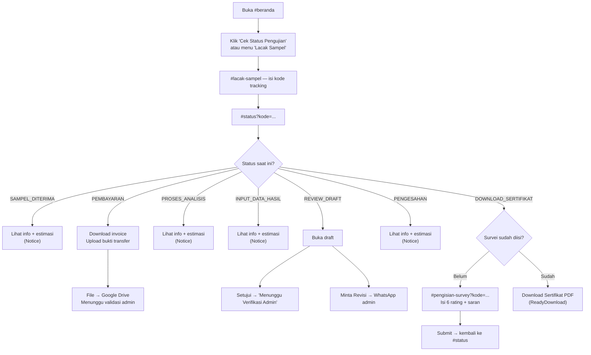
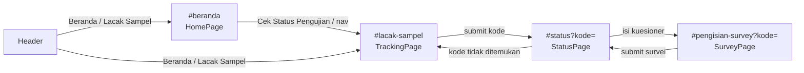

# 04. Frontend Documentation

## Ringkasan

Frontend adalah **Single Page Application (SPA)** berbasis **React 18 + Vite + Tailwind CSS 3**. Menggunakan **hash-based routing** (bukan React Router), animasi **Framer Motion**, ikon **lucide-react**, dan HTTP client **Axios**.

Seluruh frontend bersifat **publik tanpa login**. Tidak ada autentikasi, tidak ada state global (hanya state lokal per halaman).

## Struktur Folder

```
frontend/
├── index.html                  # HTML entry, memuat /src/main.jsx, font Inter
├── vite.config.js              # (tidak ada file terpisah — konfigurasi default Vite)
├── package.json                # dependencies & scripts
├── tailwind.config.js          # tema warna: leaf, soil, sun; font Inter
├── postcss.config.js           # tailwindcss + autoprefixer
├── .env                        # VITE_API_URL
├── public/
│   └── assets/images/          # logo.png, landingpage.jpg, landingpage-reference.png
├── dist/                       # hasil build production (tidak di-commit)
└── src/
    ├── main.jsx                # entry React (createRoot + StrictMode)
    ├── App.jsx                 # routing utama & perpindahan halaman
    ├── index.css               # Tailwind + global style (hero-bg, map-fallback)
    ├── components/
    │   ├── Header.jsx          # header sticky dengan navigasi
    │   ├── Footer.jsx          # footer (penuh & compact)
    │   ├── Logo.jsx            # logo + nama Lab KTNT UNPAD
    │   └── AnimatedSection.jsx # wrapper animasi (fadeUp, staggerContainer)
    ├── data/
    │   └── siteData.js         # konten statis: nav, layanan, proses, kartu alur, maps
    ├── hooks/
    │   └── useHashRoute.js     # hash routing hook
    ├── pages/
    │   ├── HomePage.jsx        # #beranda — landing page
    │   ├── TrackingPage.jsx    # #lacak-sampel — cari kode tracking
    │   ├── StatusPage.jsx      # #status?kode=... — detail status sampel
    │   └── SurveyPage.jsx      # #pengisian-survey?kode=... — kuesioner kepuasan
    └── services/
        └── api.js              # pembungkus Axios ke backend
```

---

## Entry Point

### `src/main.jsx`

- Membuat root React di `<div id="root">` (di `index.html`).
- Membungkus `<App />` dengan `<React.StrictMode>`.
- Mengimpor `./index.css`.

### `src/App.jsx`

Komponen utama yang memetakan halaman aktif → komponen halaman:

```jsx
const { page, kode, navigate } = useHashRoute()

{page === 'tracking' && <TrackingPage onNavigate={navigate} />}
{page === 'status'   && <StatusPage kodeTracking={kode} onNavigate={navigate} />}
{page === 'survey'   && <SurveyPage kodeTracking={kode} onNavigate={navigate} />}
{page === 'home'     && <HomePage onNavigate={navigate} />}
```

`Header` selalu dirender di atas; `Footer` dirender oleh masing-masing halaman.

---

## Routing — `src/hooks/useHashRoute.js`

Routing dilakukan dengan **window.location.hash** dan event `hashchange`.

Pemetaan page → hash:

| Page (internal) | Hash |
|-----------------|------|
| `home` | `#beranda` |
| `tracking` | `#lacak-sampel` |
| `status` | `#status?kode=LAB-...` |
| `survey` | `#pengisian-survey?kode=LAB-...` |

Fungsi `parseHash()` membaca hash dan query param `kode`, lalu mengembalikan `{ page, kode }`. Path tidak dikenal → fallback `home`.

Fungsi `navigate(nextPage, kode = '')` mengatur `window.location.hash` dan langsung memperbarui state route. Jika `kode` diberikan, ditambahkan sebagai `?kode=...`.

**Keuntungan hash routing**: halaman dapat di-reload langsung dan link dapat dibagikan tanpa konfigurasi server (cocok untuk static hosting).

---

## State Management

- **Tidak ada global store** (tidak ada Redux/Zustand/Context).
- **State lokal** via `useState`/`useEffect`:
  - `StatusPage`: `data`, `loading`, `error`.
  - `SurveyPage`: `q1..q6`, `saran`, `error`, `submitting`.
  - `TrackingPage`: `kodeTracking`.
- **Props drilling**: `onNavigate` dan `kodeTracking` diteruskan dari `App` ke halaman, dan dari halaman ke komponen anak.

---

## Komponen

### `src/components/Header.jsx`

- Sticky header dengan `backdrop-blur`.
- Menampilkan `Logo` (klik → `onNavigate('home')`).
- Navigasi dari `navItems` (`siteData.js`): **Beranda**, **Lacak Sampel**.
- Logika `isActiveNav`: halaman `status` juga menandai "Lacak Sampel" sebagai aktif.
- Indikator underline animasi (`layoutId="nav-underline"` dengan spring Framer Motion).

### `src/components/Footer.jsx`

- Prop `compact`:
  - `compact=true` → footer ramping (digunakan halaman Tracking/Status/Survey).
  - `compact=false` → footer besar 3 kolom (digunakan HomePage).
- Grup footer: Navigasi, Legal. Link "Kebijakan Privasi"/"Persyaratan Layanan" masih `href="#"` (placeholder).

### `src/components/Logo.jsx`

- Tombol berisi gambar `/assets/images/logo.png` + teks "Lab KTNT UNPAD".
- Hover animation scale.

### `src/components/AnimatedSection.jsx`

- Mengekspor varian Framer Motion: `fadeUp` dan `staggerContainer`.
- Komponen `AnimatedSection`: section dengan animasi `whileInView` (muncul saat discroll).

---

## Data Statis — `src/data/siteData.js`

| Ekspor | Isi |
|--------|-----|
| `navItems` | `[{ Beranda }, { Lacak Sampel }]` |
| `services` | 8 layanan: Pupuk Hayati, Pupuk Anorganik, Pupuk Organik, Pembenah Tanah Organik, Pembenah Tanah Senyawa Humat, Pembenah Tanah Anorganik, Analisis Sampel Tanah, Analisis Sampel Air (dengan ikon lucide) |
| `processSteps` | 7 tahap proses dengan `status` enum: `SAMPEL_DITERIMA`, `PEMBAYARAN`, `PROSES_ANALISIS`, `INPUT_DATA_HASIL`, `REVIEW_DRAFT`, `PENGESAHAN`, `DOWNLOAD_SERTIFIKAT` |
| `sampleFlowCards` | 3 kartu penjelasan alur: Invoice Pembayaran, Review Draft, Sertifikat Final |
| `googleMapsUrl` | Link "share" Google Maps (dipakai saat `googleMapsEmbedUrl` kosong) |
| `googleMapsEmbedUrl` | **Kosong** → UI menampilkan placeholder peta |

---

## Halaman

### 1. `HomePage.jsx` — `#beranda`

**Tujuan**: Landing page marketing + kontak.

Bagian:
- **HeroSection**: judul besar + deskripsi Lab KTNT, tombol "Cek Status Pengujian" (`onNavigate('tracking')`) dan "Lihat Layanan Kami" (anchor `#layanan`). Latar `hero-bg` dari `index.css`.
- **ServicesSection** (`#layanan`): grid 8 kartu layanan.
- **ContactSection** (`#kontak`): alamat, email `lab.ktnt@unpad.ac.id`, telepon/WA `+62 22 779 6316`, tombol WhatsApp `https://wa.me/62227796316`, dan peta (placeholder karena `googleMapsEmbedUrl` kosong).
- **Footer** penuh.

### 2. `TrackingPage.jsx` — `#lacak-sampel`

**Tujuan**: Pencarian sampel berdasarkan kode tracking.

- **SearchPanel**: form input kode → `onNavigate('status', kode)`.
- **ProcessSection**: menampilkan 7 langkah `processSteps` (stepper statis).
- **WorkflowCards**: 3 kartu `sampleFlowCards` (Invoice, Review Draft, Sertifikat).
- **Footer** compact.

### 3. `StatusPage.jsx` — `#status?kode=...`

**Tujuan**: Halaman utama interaksi pelanggan — menampilkan status dan menyediakan aksi sesuai tahap.

Alur loading:
1. Jika `kodeTracking` kosong → error "Kode tracking tidak ditemukan..."
2. Panggil `getTrackingStatus(kode)` → `data` berisi `{ order, history, certificate, latest_draft, survey_completed }`.
3. 404 → pesan kode tidak ditemukan; error lain → pesan umum. Ada tombol "Kembali ke Lacak Sampel".

Render berdasarkan `order.current_status`:

| Status | Komponen ditampilkan |
|--------|----------------------|
| Semua status | `SampleSummary` — stepper progres + info order + estimasi SLA |
| `PEMBAYARAN` | `PaymentReview` |
| `REVIEW_DRAFT` | `DraftPreview` |
| `SAMPEL_DITERIMA`, `PROSES_ANALISIS`, `INPUT_DATA_HASIL`, `PENGESAHAN` | `Notice` (info + waktu update terakhir) |
| `DOWNLOAD_SERTIFIKAT` | `survey_completed ? ReadyDownload : SurveyPrompt` |

**Sub-komponen** (semua di dalam `StatusPage.jsx`):

- `StatusStepper({ active })` — 7 langkah; langkah aktif = `active`, sebelumnya = done. Berdasarkan `processSteps`.
- `SampleSummary({ order })` — info order + estimasi (`order.estimasi.label`).
- `Notice({ title, text, updatedAt })` — banner kuning informasi status.
- `PaymentReview({ kodeTracking, invoiceUrl })`:
  - Validasi file klien: tipe `image/jpeg|png`, `application/pdf`, maks 5MB.
  - `TransferDetail` — info rekening Bank BNI `1234567890` a/n "Lab KTNT Unpad" (hardcoded).
  - `PaymentSteps` — 3 langkah: Download invoice (dari `order.invoice_file_url`), transfer, upload bukti.
  - Upload → `uploadPaymentProof(kode, file)` → tampilan sukses "Pembayaran Sedang Diperiksa".
- `DraftPreview({ kodeTracking, latestDraft, onRefresh })`:
  - Menampilkan draft versi terbaru (`latest_draft`) + tombol "Buka Draft".
  - `handleApprove` → `approveDraft(kode)` → tampilan "Menunggu Verifikasi Admin".
  - `handleRevisi` → `requestDraftRevision(kode)` → membuka `whatsapp_url` di tab baru + `onRefresh()`.
  - `ActionCard` — kartu aksi reusable (Setujui / Minta Revisi).
- `SurveyPrompt({ kodeTracking, onNavigate })` — ajakan mengisi kuesioner → `onNavigate('survey', kode)`.
- `ReadyDownload({ order, certificate })` — banner selesai + detail + tombol "Download Sertifikat PDF" (dari `certificate.link_sertifikat`).
- `refreshData()` — memanggil ulang API untuk menyegarkan data.

### 4. `SurveyPage.jsx` — `#pengisian-survey?kode=...`

**Tujuan**: Kuesioner kepuasan 6 pertanyaan (rating bintang 1–5) + saran opsional.

- `questions`: 6 pertanyaan hardcoded (kecepatan proses, keramahan admin, kejelasan info, kemudahan website, kualitas laporan, kepuasan keseluruhan).
- `RatingRow`: baris pertanyaan + 5 bintang klik.
- Validasi: semua rating harus 1–5 sebelum submit.
- Submit → `submitQuestionnaire(kode, { q1..q6, saran })` → sukses → `onNavigate('status', kode)` (kembali ke status; karena `survey_completed` sekarang true, muncul `ReadyDownload`).
- **Footer** compact.

---

## HTTP Client — `src/services/api.js`

Membungkus Axios dengan `baseURL = import.meta.env.VITE_API_URL` (default `http://localhost:3000/api`).

| Fungsi | Method + Path | Digunakan oleh |
|--------|---------------|----------------|
| `getTrackingStatus(kode)` | GET `/tracking/:kode` | `StatusPage` |
| `uploadPaymentProof(kode, file)` | POST `/payment/:kode/upload` (multipart) | `StatusPage` (`PaymentReview`) |
| `getLatestDraft(kode)` | GET `/draft/:kode/latest` | **Tidak dipakai** — route tidak ada di backend (dead code) |
| `approveDraft(kode)` | POST `/draft/:kode/approve` | `StatusPage` (`DraftPreview`) |
| `requestDraftRevision(kode)` | POST `/draft/:kode/revisi` | `StatusPage` (`DraftPreview`) |
| `submitQuestionnaire(kode, payload)` | POST `/questionnaire/:kode` | `SurveyPage` |

---

## Flow User (Pelanggan)



---

## Hubungan Antar Halaman



---

## Gaya & Tema

- **Tailwind** dengan warna khusus: `leaf` (50–900, hijau), `soil` (kuning gelap), `sun` (kuning). Definisi di `tailwind.config.js`.
- Font: **Inter** (dari Google Fonts di `index.html`).
- Global CSS: background `#fffef8`, warna teks `#2d4b31`, `scroll-behavior: smooth`.
- Latar hero: `.hero-bg` (gradient + gambar `landingpage.jpg`).
- `::selection` berwarna kuning (`#ffe55b`).

---

## Konvensi Koding Frontend

- **JSX** tanpa TypeScript (`.jsx`).
- Fungsi komponen diekspor dengan **named export** (`export function Xxx`).
- Komponen kecil didefinisikan dalam file yang sama dengan halaman (mis. `StatusStepper` di dalam `StatusPage.jsx`).
- Ikon diimpor dari `lucide-react`.
- Animasi menggunakan varian `fadeUp`/`staggerContainer` dari `AnimatedSection`.
- Tidak ada komentar penjelasan dalam kode (gaya minimalis).

---

## Catatan

1. **Dead code**: `getLatestDraft()` di `api.js` tidak pernah dipanggil dan merujuk route yang tidak ada.
2. **Data hardcoded**: rekening bank (BNI 1234567890), kontak, layanan, dan pertanyaan survei di-hardcode di file; perlu dipindah ke data dinamis/backend untuk kemudahan perawatan.
3. **Draft approval dua langkah**: setelah pelanggan klik "Lanjutkan ke Pengesahan", UI menampilkan "Menunggu Verifikasi Admin" — status order baru berubah menjadi `PENGESAHAN` setelah cron membaca sheet `Draft` berisi `Disetujui`. Jadi perubahan status tidak instan (maks 30 detik).
