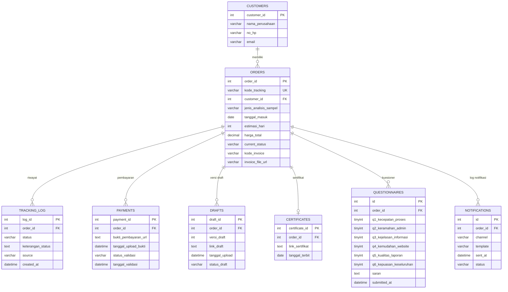

# 05. Database Documentation

## Ringkasan

Sistem menggunakan **MySQL** (via `mysql2/promise`) dengan nama database **`lab_tracking`** (dari `DB_NAME` di `.env`). Seluruh akses dilakukan dengan query SQL manual melalui connection pool (`src/config/db.js`).

> **Catatan penting**: Repositori ini **tidak menyertakan file skema SQL (migration/DDL)**. Tabel tidak dibuat otomatis oleh aplikasi. Skema di bawah ini **direkonstruksi dari query yang dipakai di kode** (INSERT/UPDATE/SELECT) dan nama kolom yang muncul di kode. Detail tipe data & constraint yang tidak bisa dipastikan ditandai dengan `(?)`.

## Daftar Tabel

| Tabel | Fungsi | Kolom kunci |
|-------|--------|-------------|
| `customers` | Data pelanggan/instansi | `customer_id` (PK), `email` (unik logika) |
| `orders` | Pesanan/sampel yang ditracking | `order_id` (PK), `kode_tracking`, `customer_id` (FK) |
| `tracking_log` | Riwayat perubahan status order | `order_id` (FK), `created_at` |
| `payments` | Bukti & validasi pembayaran | `payment_id` (PK), `order_id` (FK) |
| `drafts` | Versi draft hasil pengujian | `draft_id` (PK), `order_id` (FK) |
| `certificates` | Sertifikat hasil uji final | `certificate_id` (PK), `order_id` (FK) |
| `questionnaires` | Jawaban kuesioner kepuasan | `order_id` (FK), `submitted_at` |
| `notifications` | Log pengiriman email/WhatsApp | `order_id` (FK), `sent_at` |

---

## ERD



---

## Detail Tabel

### 1. `customers`

Menyimpan identitas pelanggan/instansi.

| Kolom | Tipe (perkiraan) | Keterangan |
|-------|------------------|------------|
| `customer_id` | INT, **PK**, AUTO_INCREMENT | |
| `nama_perusahaan` | VARCHAR (?) | Nama pelanggan/instansi |
| `no_hp` | VARCHAR (?) | Nomor HP untuk notifikasi WhatsApp |
| `email` | VARCHAR (?) | **Kunci unik logika** — dipakai untuk upsert di `syncNewOrders`; email juga tujuan notifikasi |

> **Tidak ada UNIQUE constraint pada `email`** yang terverifikasi dari kode — upsert memakai `SELECT ... WHERE email = ?` lalu insert/update. Jika duplikat email, baris terbaru yang dipakai. Perlu dipertimbangkan constraint unique.

### 2. `orders`

Tabel inti: satu baris = satu sampel/pesanan yang dilacak.

| Kolom | Tipe (perkiraan) | Keterangan |
|-------|------------------|------------|
| `order_id` | INT, **PK**, AUTO_INCREMENT | |
| `kode_tracking` | VARCHAR (?) | **Kunci unik bisnis** (contoh `LAB-2026-0001`), dipakai pelanggan untuk melacak |
| `customer_id` | INT, **FK → customers.customer_id** | |
| `jenis_analisis_sampel` | VARCHAR (?) | Jenis layanan analisis |
| `tanggal_masuk` | DATE/DATETIME (?) | Tanggal sampel diterima; dasar perhitungan SLA |
| `estimasi_hari` | INT | Jumlah hari estimasi penyelesaian |
| `harga_total` | DECIMAL (?) | Total biaya |
| `current_status` | VARCHAR (?) | **Enum status**: `SAMPEL_DITERIMA`, `PEMBAYARAN`, `PROSES_ANALISIS`, `INPUT_DATA_HASIL`, `REVIEW_DRAFT`, `PENGESAHAN`, `DOWNLOAD_SERTIFIKAT` |
| `kode_invoice` | VARCHAR (?) | Nomor invoice |
| `invoice_file_url` | VARCHAR/TEXT (?) | Link invoice (Google Drive) |

**Sumber pembuatan**: cron `syncNewOrders` membaca sheet `Data_Order`.

### 3. `tracking_log`

Riwayat audit perubahan status.

| Kolom | Tipe (perkiraan) | Keterangan |
|-------|------------------|------------|
| `log_id` (nama kolom tidak dipastikan) | INT, **PK** | Query SELECT tidak memilih kolom id; INSERT tidak menyebut id (kemungkinan AUTO_INCREMENT) |
| `order_id` | INT, **FK → orders.order_id** | |
| `status` | VARCHAR (?) | Status baru saat transisi |
| `keterangan_status` | TEXT (?) | Catatan perubahan (mis. "Order baru terdeteksi dari Google Sheets") |
| `source` | VARCHAR (?) | `ADMIN_MANUAL` (dari API) atau `AUTO_SCRIPT` (dari cron) |
| `created_at` | DATETIME | Waktu transisi (default `NOW()`) |

Setiap pemanggilan `updateOrderStatus()` selalu menambahkan satu baris di tabel ini.

### 4. `payments`

Rekam jejak bukti pembayaran dan validasinya.

| Kolom | Tipe (perkiraan) | Keterangan |
|-------|------------------|------------|
| `payment_id` | INT, **PK**, AUTO_INCREMENT | |
| `order_id` | INT, **FK → orders.order_id** | Satu order bisa punya >1 baris (upload ulang) |
| `bukti_pembayaran_url` | TEXT (?) | Link publik Google Drive |
| `tanggal_upload_bukti` | DATETIME | Saat bukti diunggah |
| `status_validasi` | VARCHAR (?) | `PENDING`, `VALID`, `INVALID` |
| `tanggal_validasi` | DATETIME (nullable) | Saat admin memvalidasi |

Query validasi memakai `ORDER BY payment_id DESC LIMIT 1` → **baris terbaru yang divalidasi**.

### 5. `drafts`

Versi draft hasil pengujian (maksimal 3 versi per order).

| Kolom | Tipe (perkiraan) | Keterangan |
|-------|------------------|------------|
| `draft_id` | INT, **PK**, AUTO_INCREMENT | |
| `order_id` | INT, **FK → orders.order_id** | |
| `versi_draft` | INT | 1 (awal), 2, 3 (maks revisi 2×) |
| `link_draft` | TEXT (?) | Link Google Drive/URL draft |
| `tanggal_upload` | DATETIME | |
| `status_draft` | VARCHAR (?) | `MENUNGGU_REVIEW`, `DISETUJUI`, `REVISI` |

### 6. `certificates`

Sertifikat Hasil Uji (SHU) final — **satu order maksimal satu baris** (dicek dengan `SELECT ... WHERE order_id = ?`).

| Kolom | Tipe (perkiraan) | Keterangan |
|-------|------------------|------------|
| `certificate_id` | INT, **PK**, AUTO_INCREMENT | |
| `order_id` | INT, **FK → orders.order_id** | |
| `link_sertifikat` | TEXT (?) | Link publik Google Drive |
| `tanggal_terbit` | DATE | Format `YYYY-MM-DD` |

### 7. `questionnaires`

Jawaban kuesioner kepuasan. Enam rating bernilai 1–5.

| Kolom | Tipe (perkiraan) | Keterangan |
|-------|------------------|------------|
| `id` (nama tidak dipastikan) | INT, **PK**, AUTO_INCREMENT | |
| `order_id` | INT, **FK → orders.order_id** | |
| `q1_kecepatan_proses` | TINYINT | Rating 1–5 |
| `q2_keramahan_admin` | TINYINT | Rating 1–5 |
| `q3_kejelasan_informasi` | TINYINT | Rating 1–5 |
| `q4_kemudahan_website` | TINYINT | Rating 1–5 |
| `q5_kualitas_laporan` | TINYINT | Rating 1–5 |
| `q6_kepuasan_keseluruhan` | TINYINT | Rating 1–5 |
| `saran` | TEXT (nullable) | Saran/masukan opsional |
| `submitted_at` | DATETIME | Default `NOW()` |

> **Tidak ada pembatasan unik**: pelanggan dapat mengisi kuesioner lebih dari sekali. `survey_completed` di API hanya mengecek **apakah minimal satu baris ada**.

### 8. `notifications`

Log pengiriman notifikasi.

| Kolom | Tipe (perkiraan) | Keterangan |
|-------|------------------|------------|
| `id` (nama tidak dipastikan) | INT, **PK**, AUTO_INCREMENT | |
| `order_id` | INT, **FK → orders.order_id** | |
| `channel` | VARCHAR (?) | `EMAIL` atau `WHATSAPP` |
| `template` | VARCHAR (?) | Status yang memicu (mis. `REVIEW_DRAFT`) |
| `sent_at` | DATETIME | Waktu pengiriman |
| `status` | VARCHAR (?) | `SENT` atau `FAILED` |

---

## Relasi (Ringkasan)

| Relasi | Tipe | Penjelasan |
|--------|------|------------|
| `customers` 1—N `orders` | 1:N | Satu customer dapat punya banyak order. `orders.customer_id` → `customers.customer_id` |
| `orders` 1—N `tracking_log` | 1:N | Riwayat status. `tracking_log.order_id` → `orders.order_id` |
| `orders` 1—N `payments` | 1:N | Satu order bisa beberapa upload bukti. `payments.order_id` → `orders.order_id` |
| `orders` 1—N `drafts` | 1:N | Hingga 3 versi. `drafts.order_id` → `orders.order_id` |
| `orders` 1—1 `certificates` | 1:0..1 | Maksimal 1 sertifikat per order (logika kode). `certificates.order_id` → `orders.order_id` |
| `orders` 1—N `questionnaires` | 1:N | Bisa lebih dari sekali. `questionnaires.order_id` → `orders.order_id` |
| `orders` 1—N `notifications` | 1:N | Log email/WA per status. `notifications.order_id` → `orders.order_id` |

---

## Lifecycle Data

```mermaid
flowchart LR
    A["Admin isi Google Sheets<br/>(Data_Order)"] -->|"cron 30 detik"| B["INSERT customers + orders<br/>current_status = SAMPEL_DITERIMA"]
    B --> C["INSERT tracking_log + notifications<br/>(SAMPEL_DITERIMA)"]
    C --> D["Pelanggan upload bukti bayar"]
    D --> E["INSERT payments (PENDING)"]
    E --> F["Admin validasi → status PROSES_ANALISIS"]
    F --> G["Admin update status di Sheets<br/>(Proses Analisis / Input Data Hasil)"]
    G -->|"cron"| H["UPDATE orders.current_status + tracking_log"]
    H --> I["Admin upload draft (API / Sheets)"]
    I -->|"cron"| J["INSERT drafts (v1) + status REVIEW_DRAFT"]
    J --> K["Pelanggan setujui draft"]
    K -->|"cron (sheet Draft=Disetujui)"| L["status PENGESAHAN"]
    L --> M["Admin isi Sertifikat di Sheets"]
    M -->|"cron"| N["INSERT certificates"]
    N --> O["Admin set status DOWNLOAD_SERTIFIKAT via Sheets"]
    O -->|"cron"| P["status DOWNLOAD_SERTIFIKAT + notifikasi"]
    P --> Q["Pelanggan isi kuesioner"]
    Q --> R["INSERT questionnaires → sertifikat dapat diunduh"]
```



**Titik akhir siklus**: Status `DOWNLOAD_SERTIFIKAT` + `questionnaires` terisi = selesai.

---

## Nilai-nilai Enumerasi

### `orders.current_status`

```
SAMPEL_DITERIMA → PEMBAYARAN → PROSES_ANALISIS → INPUT_DATA_HASIL → REVIEW_DRAFT → PENGESAHAN → DOWNLOAD_SERTIFIKAT
```

Urutan ini didefinisikan di `cronSyncService.STATUS_ORDER`. Sinkronisasi manual **hanya maju** (tidak pernah mundur).

### `payments.status_validasi`

```
PENDING → VALID | INVALID
```

### `drafts.status_draft`

```
MENUNGGU_REVIEW → DISETUJUI | REVISI
```

### `notifications.channel` / `.status`

```
channel: EMAIL | WHATSAPP
status:  SENT | FAILED
```

### `tracking_log.source`

```
ADMIN_MANUAL  (perubahan via API/controller)
AUTO_SCRIPT   (perubahan via cron sinkronisasi)
```

---

## Catatan & Risiko Skema

1. **Skema tidak ada di repositori** — tidak ada file `.sql`/migration. Tim harus membuat database manual. Disarankan menambahkan file migration ke depan.
2. **Nama PK tabel log/kuesioner/notifikasi tidak dapat dipastikan** dari kode (INSERT tidak menyebut kolom id; dianggap AUTO_INCREMENT).
3. **Tidak ada UNIQUE constraint terverifikasi** untuk `orders.kode_tracking` dan `customers.email` — kode bergantung pada logika upsert.
4. **`questionnaires` bisa berisi banyak baris per order** — bisa menghasilkan "survei_completed = true" walaupun ada lebih dari satu pengisian.
5. **Tanpa transaksi**: operasi yang melibatkan beberapa tabel (update status + log + notifikasi) tidak dibungkus transaction; kegagalan di tengah jalan bisa membuat data tidak konsisten.
6. **`payments` vs `drafts`** memakai pola "selalu insert, ambil baris terbaru" (`ORDER BY ... DESC LIMIT 1`) — riwayat lama tetap tersimpan.
