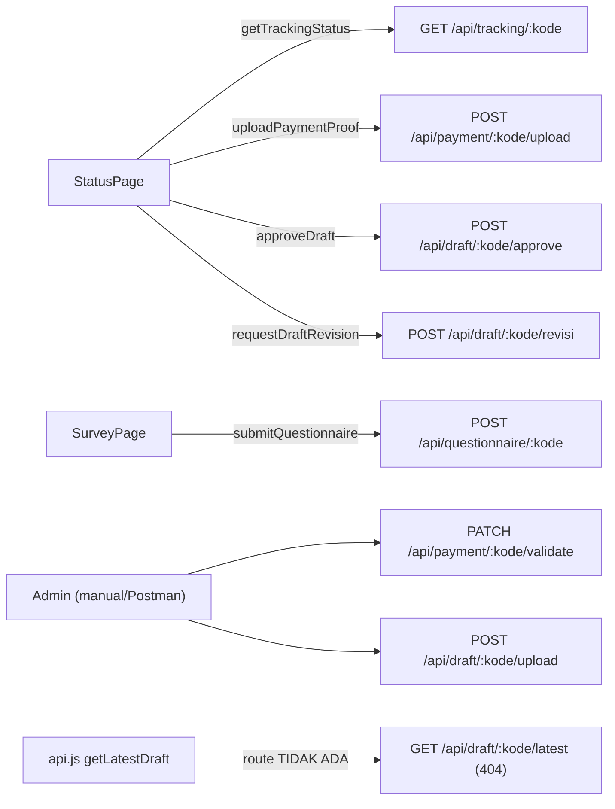

# 06. API Documentation

## Dasar

- **Base URL**: `http://localhost:3000` (variabel `PORT`, default 3000).
- **Prefiks API**: `/api`.
- **Format**: JSON (`Content-Type: application/json`), kecuali upload file (multipart).
- **CORS**: Hanya origin di `ALLOWED_ORIGIN` yang diizinkan (default localhost:5173/5174).
- **Rate limiting**:
  - Global: 100 request/menit.
  - `/api/tracking`: 30 request/menit.
- **Autentikasi**: **Tidak ada** di semua endpoint.
- **Kode tracking**: harus cocok regex `^[A-Za-z0-9_-]+$`.
- **Error handler global**: `413` (file terlalu besar), `500` (error server, pesan generik), `400` (validasi), `404` (tidak ditemukan).

## Daftar Endpoint

| # | Method | URL | Tujuan | Halaman |
|---|--------|-----|--------|---------|
| 1 | GET | `/health` | Health check server | — (cek manual) |
| 2 | GET | `/api/tracking/:kode_tracking` | Ambil status tracking lengkap | StatusPage |
| 3 | POST | `/api/payment/:kode_tracking/upload` | Upload bukti pembayaran | StatusPage (PaymentReview) |
| 4 | PATCH | `/api/payment/:kode_tracking/validate` | Validasi pembayaran (admin) | — (belum ada UI) |
| 5 | POST | `/api/draft/:kode_tracking/upload` | Upload draft (admin) | — (belum ada UI) |
| 6 | POST | `/api/draft/:kode_tracking/approve` | Setujui draft (pelanggan) | StatusPage (DraftPreview) |
| 7 | POST | `/api/draft/:kode_tracking/revisi` | Ajukan revisi draft (pelanggan) | StatusPage (DraftPreview) |
| 8 | POST | `/api/questionnaire/:kode_tracking` | Submit kuesioner kepuasan | SurveyPage |

> **Catatan**: Frontend `services/api.js` juga mendefinisikan `getLatestDraft` → `GET /api/draft/:kode/latest`, tetapi route ini **tidak ada** di backend. Endpoint tersebut tidak didokumentasikan sebagai aktif dan bersifat *dead code*.

---

## 1. GET `/health`

**Tujuan**: Mengecek apakah server berjalan.

**Request**: Tanpa parameter.

**Response** `200`:
```json
{
  "status": "ok",
  "message": "Backend Lab Tracking jalan!"
}
```

**Digunakan oleh**: — (pengecekan manual/operasional).

---

## 2. GET `/api/tracking/:kode_tracking`

**Tujuan**: Mengambil seluruh data status satu order: data order, estimasi SLA, riwayat status, sertifikat, draft terbaru, dan status kuesioner.

**Middleware**: `validateTrackingCode`, `trackingLimiter`.

**Path parameter**:

| Param | Ketentuan |
|-------|-----------|
| `kode_tracking` | Regex `^[A-Za-z0-9_-]+$` |

**Response** `200`:
```json
{
  "order": {
    "order_id": 1,
    "kode_tracking": "LAB-2026-0001",
    "jenis_analisis_sampel": "Analisis Sampel Tanah",
    "tanggal_masuk": "2026-08-01T00:00:00.000Z",
    "estimasi_hari": 14,
    "harga_total": 1500000,
    "current_status": "REVIEW_DRAFT",
    "kode_invoice": "INV-2026-0001",
    "invoice_file_url": "https://drive.google.com/...",
    "nama_perusahaan": "PT Pertanian Nusantara",
    "no_hp": "081234567890",
    "email": "customer@example.com",
    "estimasi": {
      "tanggal_estimasi_selesai": "2026-08-15",
      "sisa_hari": 9,
      "label": "9 Hari Lagi"
    }
  },
  "history": [
    {
      "status": "SAMPEL_DITERIMA",
      "keterangan_status": "Order baru terdeteksi dari Google Sheets",
      "source": "AUTO_SCRIPT",
      "created_at": "2026-08-01T01:00:00.000Z"
    }
  ],
  "certificate": {
    "link_sertifikat": "https://drive.google.com/...",
    "tanggal_terbit": "2026-08-20"
  },
  "latest_draft": {
    "versi_draft": 1,
    "link_draft": "https://drive.google.com/...",
    "status_draft": "MENUNGGU_REVIEW",
    "tanggal_upload": "2026-08-15T00:00:00.000Z"
  },
  "survey_completed": false
}
```

**Field penting**:
- `order.estimasi.label` — salah satu dari `"X Hari Lagi"`, `"Estimasi Selesai Hari Ini"`, `"Terlambat X Hari"`.
- `certificate` — `null` jika belum ada.
- `latest_draft` — `null` jika belum ada draft.
- `survey_completed` — `true` jika minimal satu kuesioner sudah dikirim.

**Response error**:
- `400` — format kode tidak valid.
- `404` — `{ "message": "Kode tracking tidak ditemukan." }`
- `429` — rate limit terlampaui.

**Digunakan oleh**: `StatusPage` (saat load & saat `refreshData`).

---

## 3. POST `/api/payment/:kode_tracking/upload`

**Tujuan**: Menerima file bukti pembayaran pelanggan, menyimpannya ke Google Drive, menyimpan record di database, dan menulis tanggal+link ke Google Sheets.

**Middleware**: `validateTrackingCode`, `upload.single('bukti_pembayaran')`.

**Request** — `multipart/form-data`:

| Field | Tipe | Ketentuan |
|-------|------|-----------|
| `bukti_pembayaran` | file | JPG, PNG, atau PDF; maksimal 5MB |

**Response** `201`:
```json
{
  "message": "Bukti pembayaran berhasil diupload, menunggu validasi admin.",
  "link": "https://drive.google.com/... (webViewLink)"
}
```

**Response error**:
- `400` — file tidak ada / tipe tidak didukung.
- `404` — kode tracking tidak ditemukan.
- `413` — file > 5MB (`LIMIT_FILE_SIZE`).
- `500` — gagal server/Drive.

**Side-effect**:
- `payments` baru dengan `status_validasi = 'PENDING'`.
- Google Sheets sheet `Pembayaran`: kolom B = tanggal upload, kolom C = link.

**Digunakan oleh**: `StatusPage` (`PaymentReview`).

---

## 4. PATCH `/api/payment/:kode_tracking/validate`

**Tujuan**: Admin menandai bukti pembayaran `VALID` atau `INVALID`. Jika `VALID`, status order otomatis menjadi `PROSES_ANALISIS` (dengan notifikasi email/WA).

**Middleware**: `validateTrackingCode`.

**Request** — JSON:
```json
{
  "status_validasi": "VALID"
}
```
Nilai yang diizinkan: `VALID` | `INVALID`.

**Response** `200`:
```json
{
  "message": "Pembayaran ditandai VALID."
}
```

**Response error**:
- `400` — nilai `status_validasi` bukan `VALID`/`INVALID`.
- `404` — kode tracking tidak ditemukan.
- `500` — error server.

**Side-effect**:
- `payments` baris terbaru di-update (`status_validasi`, `tanggal_validasi`).
- Jika `VALID` → `updateOrderStatus(..., 'PROSES_ANALISIS', 'Pembayaran divalidasi admin', 'ADMIN_MANUAL')` → `tracking_log` + notifikasi.

**Digunakan oleh**: **Belum ada UI** — endpoint admin, dipanggil manual (Postman/curl).

> ⚠️ Tanpa autentikasi: siapa pun yang tahu kode dapat memanggil endpoint ini.

---

## 5. POST `/api/draft/:kode_tracking/upload`

**Tujuan**: Admin mengunggah/memperbarui draft hasil pengujian (link Google Drive). Versi pertama mengubah status order menjadi `REVIEW_DRAFT`.

**Middleware**: `validateTrackingCode`.

**Request** — JSON:
```json
{
  "link_draft": "https://drive.google.com/..."
}
```

**Response** `201`:
```json
{
  "message": "Draft versi 1 berhasil diupload."
}
```

**Response error**:
- `400` — `link_draft` kosong/bukan URL valid; atau batas revisi (maks 3 versi / 2 revisi) tercapai.
- `404` — kode tracking tidak ditemukan.
- `500` — error server.

**Side-effect**:
- `drafts` baru dengan `status_draft = 'MENUNGGU_REVIEW'`.
- Jika versi 1 → `updateOrderStatus(..., 'REVIEW_DRAFT', 'Draft pertama diupload admin', 'ADMIN_MANUAL')` + notifikasi.

**Digunakan oleh**: **Belum ada UI** — endpoint admin.

> ⚠️ Tanpa autentikasi.

---

## 6. POST `/api/draft/:kode_tracking/approve`

**Tujuan**: Pelanggan menyetujui draft → dilanjutkan ke proses pengesahan.

**Middleware**: `validateTrackingCode`.

**Request**: Tanpa body.

**Response** `200`:
```json
{
  "message": "Persetujuan Anda telah dikirim, menunggu verifikasi admin."
}
```

**Response error**:
- `404` — kode tracking tidak ditemukan.
- `500` — error server.

**Side-effect**:
- `drafts` baris terbaru → `status_draft = 'DISETUJUI'`.
- Google Sheets sheet `Draft`: kolom F = tanggal persetujuan (format `id-ID`, mis. `6 Agustus 2026`).
- ⚠️ **Status order TIDAK langsung berubah.** Perubahan ke `PENGESAHAN` terjadi saat cron `syncDraftApprovals` mendeteksi kolom status draft di Sheets bernilai `Disetujui` (admin mengubahnya, atau nilai di-isi dari sumber lain).

**Digunakan oleh**: `StatusPage` (`DraftPreview` → "Lanjutkan ke Pengesahan").

---

## 7. POST `/api/draft/:kode_tracking/revisi`

**Tujuan**: Pelanggan meminta revisi draft. Sistem mengarahkan pelanggan ke WhatsApp admin untuk detail revisi.

**Middleware**: `validateTrackingCode`.

**Request**: Tanpa body.

**Response** `200`:
```json
{
  "message": "Silakan lanjutkan ke WhatsApp admin untuk detail revisi.",
  "whatsapp_url": "https://wa.me/6287xxxx?text=Revisi%20draft%20untuk%20kode%20tracking%20LAB-2026-0001"
}
```

**Response error**:
- `400` — batas maksimal 2 revisi tercapai.
- `404` — kode tracking tidak ditemukan.
- `500` — error server.

**Side-effect**:
- `drafts` baris terbaru → `status_draft = 'REVISI'`.
- Google Sheets sheet `Draft`: kolom E = `'Revisi'`.
- Frontend membuka `whatsapp_url` di tab baru.

**Digunakan oleh**: `StatusPage` (`DraftPreview` → "Ajukan Catatan Revisi").

---

## 8. POST `/api/questionnaire/:kode_tracking`

**Tujuan**: Menyimpan jawaban kuesioner kepuasan pelanggan.

**Middleware**: `validateTrackingCode`.

**Request** — JSON:
```json
{
  "q1": 5,
  "q2": 4,
  "q3": 5,
  "q4": 4,
  "q5": 5,
  "q6": 5,
  "saran": "Pelayanannya sangat baik."
}
```

**Ketentuan**:
- `q1`–`q6` **wajib**, harus **integer 1–5**.
- `saran` opsional.

**Response** `201`:
```json
{
  "message": "Survei berhasil dikirim."
}
```

**Response error**:
- `400` — field wajib kosong atau rating di luar 1–5.
- `404` — kode tracking tidak ditemukan.
- `500` — error server.

**Side-effect**:
- `questionnaires` baru dengan `submitted_at = NOW()`.
- Tidak ada pembatasan pengisian ulang.

**Digunakan oleh**: `SurveyPage`.

---

## Matriks Penggunaan Endpoint ↔ Halaman Frontend



---

## Catatan Umum

1. **Endpoint admin tidak memiliki otentikasi** — validasi pembayaran dan upload draft dapat dipanggil publik.
2. **Tidak ada validasi "siapa pemilik order"** — kode tracking dapat ditebak/di-bruteforce (walaupun rate limit membantu di endpoint tracking).
3. **Status order tidak selalu berubah instan** setelah aksi pelanggan — transisi tertentu (mis. `REVIEW_DRAFT` → `PENGESAHAN`) bergantung pada cron sinkronisasi (maksimal 30 detik) dan aksi admin di Google Sheets.
4. **Tidak ada test otomatis** untuk endpoint.
