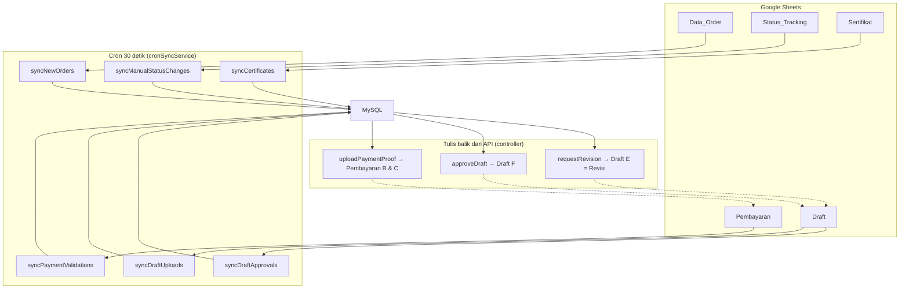

# 07. Google Sheets Integration

## Ringkasan

Google Sheets berperan sebagai **master data operasional admin**. Admin Laboratorium bekerja langsung di spreadsheet (menginput order, mengubah status, mencatat pembayaran/draft/sertifikat), dan backend menyinkronkan perubahan tersebut ke MySQL secara berkala.

- **Akses**: Google Sheets API v4 menggunakan **Service Account** (`backend/credentials/service-account.json`, path dari env `GOOGLE_SERVICE_ACCOUNT_PATH`).
- **Spreadsheet**: diidentifikasi oleh `GOOGLE_SHEETS_ID` di `.env`.
- **Sinkronisasi**: cron job backend setiap **30 detik** (`cronSyncService.runSync()`).
- **Arah data**:
  - Sheets → MySQL (utama, oleh cron).
  - MySQL/API → Sheets (selektif, oleh controller: tanggal upload bukti bayar, link, tanggal persetujuan, tanda revisi).

---

## Struktur Sheet (Tab)

Berikut **5 tab** yang dibaca/ditulis kode. Kolom dicatat berdasarkan indeks yang dipakai kode (`row[0]` = kolom A, dst.).

### 1. `Data_Order` — Sumber pembuatan order

Dibaca oleh `syncNewOrders()` (range `A2:J1000`).

| Kolom | Index | Isi | Contoh |
|-------|-------|-----|--------|
| A | 0 | **Kode Tracking** | `LAB-2026-0001` |
| B | 1 | Tanggal Masuk | `2026-08-01` |
| C | 2 | Nama Perusahaan | `PT Pertanian Nusantara` |
| D | 3 | Jenis Analisis Sampel | `Analisis Sampel Tanah` |
| E | 4 | No. HP | `081234567890` |
| F | 5 | Email | `customer@example.com` |
| G | 6 | Estimasi Hari | `14` (angka diekstrak dari teks) |
| H | 7 | Kode Invoice | `INV-2026-0001` |
| I | 8 | Harga Total | `1.500.000` (angka/desimal diekstrak) |
| J | 9 | Link Invoice | `https://drive.google.com/...` |

**Aturan proses**:
- Baris tanpa kode tracking, tanpa nama perusahaan, atau tanpa email → **dilewati**.
- **Upsert customer** berdasarkan email (update nama & no_hp bila sudah ada).
- **Upsert order** berdasarkan kode tracking. Order baru dibuat dengan `current_status = 'SAMPEL_DITERIMA'` dan memicu notifikasi email/WA.

### 2. `Status_Tracking` — Perubahan status manual admin

Dibaca oleh `syncManualStatusChanges()` (range `A2:E1000`).

| Kolom | Index | Isi |
|-------|-------|-----|
| A | 0 | Kode Tracking |
| B | 1 | **Label Status** (teks Sheets) |
| C | 2 | Keterangan |
| D | 3 | *(tidak dibaca kode)* |
| E | 4 | *(tidak dibaca kode)* |

**Label → enum** (`STATUS_LABEL_TO_ENUM`):

| Label di Sheets | Enum MySQL |
|-----------------|------------|
| `Sampel Diterima` | `SAMPEL_DITERIMA` |
| `Pembayaran` | `PEMBAYARAN` |
| `Proses Analisis` | `PROSES_ANALISIS` |
| `Input Data Hasil` | `INPUT_DATA_HASIL` |
| `Review Draft` | `REVIEW_DRAFT` |
| `Pengesahan` | `PENGESAHAN` |
| `Download Sertifikat` | `DOWNLOAD_SERTIFIKAT` |

**Aturan proses**:
- Label tidak dikenali → dilewati.
- **Hanya status maju** yang diterapkan (sesuai urutan `STATUS_ORDER`); status mundur diabaikan.
- Saat diterapkan → `updateOrderStatus` dengan `source = 'AUTO_SCRIPT'` + notifikasi (jika status punya template).

### 3. `Pembayaran` — Bukti & validasi pembayaran

Dibaca oleh `syncPaymentValidations()` (range `A2:H1000`); ditulis oleh `paymentController.uploadPaymentProof`.

| Kolom | Index | Isi | Penulis |
|-------|-------|-----|---------|
| A | 0 | Kode Tracking | Admin |
| B | 1 | **Tanggal Upload Bukti** | **Backend (API)** saat pelanggan upload |
| C | 2 | **Link Bukti Pembayaran** | **Backend (API)** saat pelanggan upload |
| D | 3 | **Status Validasi** (`PENDING`/`VALID`/`INVALID`) | Admin |
| E–H | 4–7 | *(tidak dibaca/ditulis kode)* | — |

**Aturan proses**:
- `syncPaymentValidations` hanya memproses baris dengan D = `VALID` **tepat** (case-sensitive).
- Jika order saat ini `PEMBAYARAN` → status berubah ke `PROSES_ANALISIS` (source `AUTO_SCRIPT`).
- Jika order sudah di status lebih maju → tidak ada perubahan.

### 4. `Draft` — Versi draft & persetujuan

Dibaca oleh `syncDraftUploads()` (`A2:F1000`) dan `syncDraftApprovals()` (`A2:E1000`); ditulis oleh `draftController`.

| Kolom | Index | Isi | Penulis |
|-------|-------|-----|---------|
| A | 0 | Kode Tracking | Admin |
| B | 1 | **Versi Draft** (1–3) | Admin |
| C | 2 | **Link Draft** | Admin |
| D | 3 | **Tanggal Upload** | Admin |
| E | 4 | **Status Draft** (`MENUNGGU_REVIEW` / `Disetujui` / `REVISI`) | Admin; tanda `Revisi` ditulis backend saat pelanggan minta revisi |
| F | 5 | **Tanggal Disetujui Customer** | **Backend (API)** saat pelanggan approve |

**Aturan proses `syncDraftUploads`**:
- Versi harus 1–3 (int), link harus ada, tanggal harus valid.
- Normalisasi status draft: `MENUNGGU_REVIEW`/`DISETUJUI`/`REVISI`; lainnya → fallback `MENUNGGU_REVIEW`.
- Jika kombinasi `(order_id, versi_draft)` sudah ada di DB → **dilewati** (idempotent).
- Draft versi 1 yang baru → status order `REVIEW_DRAFT` + notifikasi.

**Aturan proses `syncDraftApprovals`**:
- Hanya memproses baris dengan E = **`Disetujui`** (tepat, case-sensitive).
- Jika order saat ini `REVIEW_DRAFT` → status `PENGESAHAN` + notifikasi.

### 5. `Sertifikat` — Sertifikat final

Dibaca oleh `syncCertificates()` (range `A2:C1000`).

| Kolom | Index | Isi |
|-------|-------|-----|
| A | 0 | Kode Tracking |
| B | 1 | Link Sertifikat |
| C | 2 | Tanggal Terbit |

**Aturan proses**:
- Link wajib ada, tanggal harus valid.
- Jika order sudah punya sertifikat di DB → dilewati (idempotent).
- **Tidak** mengubah status order → status `DOWNLOAD_SERTIFIKAT` diatur admin lewat sheet `Status_Tracking`.

---

## Sinkronisasi

### Trigger & Jadwal

| Jenis | Kapan | Fungsi |
|-------|-------|--------|
| **Cron (pull)** | Setiap 30 detik (`*/30 * * * * *`) | `runSync()` — menjalankan 6 sub-sinkronisasi |
| **API (push)** | Saat pelanggan upload bukti bayar / approve / revisi | `updateCell()` + `findRowByKodeTracking()` |

### Diagram alur sinkronisasi

### Urutan eksekusi `runSync()`

1. `syncNewOrders()` — pastikan order & customer ada.
2. `syncDraftUploads()` — draft baru (butuh order ada).
3. `syncPaymentValidations()` — validasi pembayaran (butuh order ada).
4. `syncDraftApprovals()` — persetujuan draft (butuh order ada).
5. `syncCertificates()` — sertifikat baru (butuh order ada).
6. `syncManualStatusChanges()` — status manual admin (terakhir).

> Jika salah satu fungsi melempar error, iterasi `runSync` berhenti (tidak ada try/catch per fungsi).

---

## Hubungan dengan Database

| Sheet | Tabel MySQL | Arah | Kunci penghubung |
|-------|-------------|------|------------------|
| `Data_Order` | `customers`, `orders` | Sheets → MySQL | `kode_tracking` = `orders.kode_tracking`; `email` = key upsert customer |
| `Status_Tracking` | `orders.current_status`, `tracking_log` | Sheets → MySQL | `kode_tracking` |
| `Pembayaran` | `payments` | Kedua arah | `kode_tracking` |
| `Draft` | `drafts` | Kedua arah | `kode_tracking`, `versi_draft` |
| `Sertifikat` | `certificates` | Sheets → MySQL | `kode_tracking` |

**Catatan kunci penghubung**: tidak ada kolom ID numerik bersama — semua koneksi dilakukan lewat `kode_tracking` (kolom A di setiap sheet). Backend menerjemahkannya ke `order_id` saat menulis ke MySQL.

---

## Konfigurasi Lingkungan

| Variabel | Fungsi |
|----------|--------|
| `GOOGLE_SHEETS_ID` | ID spreadsheet (unik Google) |
| `GOOGLE_SERVICE_ACCOUNT_PATH` | Path file kredensial Service Account (relatif ke `backend/`) |
| `GOOGLE_DRIVE_FOLDER_BUKTI_PEMBAYARAN` | Folder Drive untuk bukti pembayaran (dipakai `driveService`) |

> Variabel `GOOGLE_DRIVE_FOLDER_INVOICE`, `GOOGLE_DRIVE_FOLDER_DRAFT`, `GOOGLE_DRIVE_FOLDER_SERTIFIKAT` didefinisikan di `.env` tetapi **belum digunakan** dalam kode.

---

## Risiko & Catatan Operasional

1. **Kunci kecocokan rentan** — pencarian baris memakai `findRowByKodeTracking` dengan nilai kolom A persis sama; duplikasi kode tracking di sheet akan membuat baris pertama yang cocok (untuk tulis balik) atau perilaku tak terduga (untuk sync).
2. **Penulisan sel dari API** — saat pelanggan upload bukti bayar, backend **menimpa** kolom B & C di baris yang cocok. Jika ada beberapa baris dengan kode sama, hanya baris pertama yang diperbarui.
3. **Konsistensi terbatas** — sinkronisasi dua arah tanpa mekanisme lock/versioning. Admin mengubah sheet sementara cron membaca bisa menyebabkan kondisi balapan (jarang, tapi mungkin).
4. **Ketergantungan internet** — semua operasi Sheets/Drive bergantung pada koneksi internet dan validitas kredensial; kegagalan akan membuat cron `runSync` error.
5. **Tanggal di Sheets** — format tanggal harus bisa di-parse `new Date()` oleh Node; format lain akan dilewati dengan log `[SYNC] ... skip ... format tanggal tidak valid`.
6. **Status label case-sensitive** — mis. `syncDraftApprovals` hanya menerima `Disetujui`; `syncPaymentValidations` hanya menerima `VALID`. Perlu konsistensi penulisan admin.
