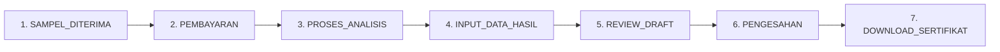
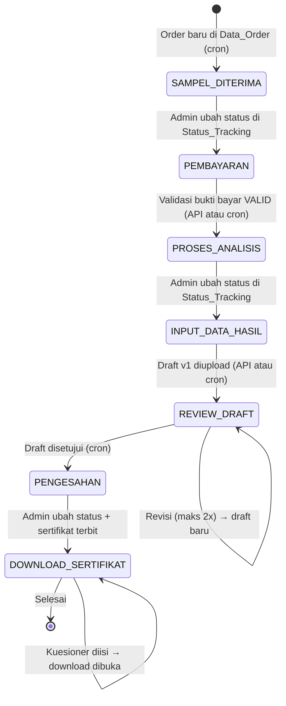

# 08. Status Tracking

## Gambaran Umum

Setiap order (sampel) melewati **7 tahap status**. Status disimpan di `orders.current_status` (enum) dan setiap transisi dicatat di `tracking_log` dengan `source` (`ADMIN_MANUAL` atau `AUTO_SCRIPT`).

### Urutan Status

### Keterangan enum & label

| Urutan | Enum (MySQL) | Label di Sheets | Label di UI (siteData) |
|--------|--------------|-----------------|------------------------|
| 1 | `SAMPEL_DITERIMA` | `Sampel Diterima` | Sampel Diterima |
| 2 | `PEMBAYARAN` | `Pembayaran` | Pembayaran |
| 3 | `PROSES_ANALISIS` | `Proses Analisis` | Analisis |
| 4 | `INPUT_DATA_HASIL` | `Input Data Hasil` | Input Data |
| 5 | `REVIEW_DRAFT` | `Review Draft` | Review Draft |
| 6 | `PENGESAHAN` | `Pengesahan` | Pengesahan |
| 7 | `DOWNLOAD_SERTIFIKAT` | `Download Sertifikat` | Unduh Sertifikat |

> **Aturan sinkronisasi**: transisi status dari sheet `Status_Tracking` **hanya boleh maju** mengikuti urutan di atas; status mundur diabaikan.

---

## Detail Setiap Status

### 1. SAMPEL_DITERIMA

- **Tujuan**: Menandai sampel telah diterima dan diregistrasi oleh lab.
- **Siapa yang mengubah**:
  - **Otomatis** (cron `syncNewOrders`): order baru terdeteksi dari sheet `Data_Order`, `source = AUTO_SCRIPT`.
- **Trigger**: Admin menambahkan baris order baru di sheet `Data_Order`.
- **Notifikasi**: Email + WhatsApp (`SAMPEL_DITERIMA`) → "Sampel Anda telah diterima".
- **Kondisi lanjut**: Admin mengubah status di sheet `Status_Tracking` menjadi `Pembayaran` (dibaca cron). *(Catatan: tidak ada mekanisme otomatis khusus yang memindahkan ke `PEMBAYARAN`.)*

### 2. PEMBAYARAN

- **Tujuan**: Menunggu pelanggan melunasi biaya dan mengunggah bukti pembayaran.
- **Siapa yang mengubah**:
  - **Admin** via sheet `Status_Tracking` → `Pembayaran` (dibaca cron, `AUTO_SCRIPT`).
- **Trigger**: Admin menetapkan status di Google Sheets.
- **Aksi pelanggan di UI**: Halaman status menampilkan `PaymentReview` — download invoice, transfer ke rekening, upload bukti (JPG/PNG/PDF ≤5MB).
- **Notifikasi**: **Tidak ada template** email/WA untuk status ini.
- **Kondisi lanjut**: Admin validasi bukti bayar menjadi `VALID` → status `PROSES_ANALISIS`.

### 3. PROSES_ANALISIS

- **Tujuan**: Sampel sedang dianalisis oleh tim lab (pengujian).
- **Siapa yang mengubah** (ada 3 jalur):
  1. **API** — `PATCH /api/payment/:kode/validate` dengan `VALID`, `source = ADMIN_MANUAL` (pesan: "Pembayaran divalidasi admin").
  2. **Cron** `syncPaymentValidations` — saat sheet `Pembayaran` kolom D = `VALID` dan order masih `PEMBAYARAN`, `source = AUTO_SCRIPT`.
  3. **Admin** via sheet `Status_Tracking` → `Proses Analisis`.
- **Trigger**: Validasi pembayaran berhasil.
- **Notifikasi**: Email + WhatsApp (`PROSES_ANALISIS`) → "Pembayaran Terverifikasi - Analisis Dimulai".
- **Kondisi lanjut**: Admin mengubah status di sheet `Status_Tracking` menjadi `Input Data Hasil`.

### 4. INPUT_DATA_HASIL

- **Tujuan**: Hasil pengujian diinput, diverifikasi, dan dipersiapkan menjadi draft.
- **Siapa yang mengubah**:
  - **Admin** via sheet `Status_Tracking` → `Input Data Hasil`.
- **Trigger**: Admin menetapkan status di Google Sheets.
- **Notifikasi**: **Tidak ada template** untuk status ini.
- **Kondisi lanjut**: Admin mengupload draft (via API `POST /api/draft/:kode/upload` atau mengisi sheet `Draft`). Saat draft versi 1 terdeteksi, status otomatis `REVIEW_DRAFT`.

### 5. REVIEW_DRAFT

- **Tujuan**: Draft hasil siap ditinjau pelanggan; pelanggan dapat **menyetujui** atau **meminta revisi**.
- **Siapa yang mengubah** (ada 2 jalur):
  1. **API** — `POST /api/draft/:kode/upload` untuk versi 1, `source = ADMIN_MANUAL` (pesan: "Draft pertama diupload admin").
  2. **Cron** `syncDraftUploads` — saat draft versi 1 terdeteksi di sheet `Draft` dan order belum `REVIEW_DRAFT`, `source = AUTO_SCRIPT`.
- **Trigger**: Draft versi 1 tersedia.
- **Notifikasi**: Email + WhatsApp (`REVIEW_DRAFT`) → "Draft Hasil Siap Ditinjau".
- **Aksi pelanggan di UI**: `DraftPreview` — tombol "Buka Draft", "Lanjutkan ke Pengesahan" (`approve`), "Ajukan Catatan Revisi" (`revisi`).
- **Revisi**: Maksimal **2 kali revisi** (total 3 versi draft). Setelah melewati batas, request revisi ditolak (`400`).
- **Kondisi lanjut**: Draft disetujui → status `PENGESAHAN`.

### 6. PENGESAHAN

- **Tujuan**: Dokumen hasil final diproses untuk pengesahan/penandatanganan (mis. oleh kepala laboratorium).
- **Siapa yang mengubah**:
  - **Cron** `syncDraftApprovals` — saat sheet `Draft` kolom E = `Disetujui` dan order saat ini `REVIEW_DRAFT`, `source = AUTO_SCRIPT`.
- **Trigger**: Persetujuan draft (pelanggan klik approve → backend menulis tanggal ke kolom F sheet `Draft`; admin menandai status `Disetujui` di kolom E). Perubahan status **tidak instan** — menunggu cron berikutnya (maks 30 detik).
- **Notifikasi**: Email + WhatsApp (`PENGESAHAN`) → "Draft Disetujui - Proses Pengesahan".
- **Kondisi lanjut**: Sertifikat diterbitkan → admin mengubah status di sheet `Status_Tracking` menjadi `Download Sertifikat`.

### 7. DOWNLOAD_SERTIFIKAT

- **Tujuan**: Sertifikat Hasil Uji (SHU) sudah terbit; pelanggan dapat mengunduhnya setelah mengisi kuesioner kepuasan.
- **Siapa yang mengubah**:
  - **Admin** via sheet `Status_Tracking` → `Download Sertifikat` (dibaca cron). *(Sertifikat itu sendiri di-input admin ke sheet `Sertifikat` dan disinkronkan cron `syncCertificates` — tetapi itu tidak mengubah status order.)*
- **Trigger**: Admin menetapkan status di Google Sheets.
- **Notifikasi**: Email + WhatsApp (`DOWNLOAD_SERTIFIKAT`) → "Sertifikat Anda Siap Diunduh".
- **Aksi pelanggan di UI**:
  - Jika `survey_completed = false` → `SurveyPrompt` (ajakan mengisi kuesioner).
  - Jika `survey_completed = true` → `ReadyDownload` (tombol "Download Sertifikat PDF" dari `certificate.link_sertifikat`).
- **Kondisi selesai**: Order dianggap selesai ketika status `DOWNLOAD_SERTIFIKAT` **dan** kuesioner terisi.

---

## Diagram Lifecycle Lengkap

---

## Tabel Ringkasan Transisi

| Dari | Ke | Pemicu | Sumber perubahan | Notifikasi |
|------|----|--------|------------------|------------|
| (baru) | `SAMPEL_DITERIMA` | Baris baru di `Data_Order` | Cron (`AUTO_SCRIPT`) | ✅ Email+WA |
| `SAMPEL_DITERIMA` | `PEMBAYARAN` | `Status_Tracking` = Pembayaran | Cron | ❌ |
| `PEMBAYARAN` | `PROSES_ANALISIS` | Validasi `VALID` (API) | API (`ADMIN_MANUAL`) | ✅ Email+WA |
| `PEMBAYARAN` | `PROSES_ANALISIS` | `Pembayaran` kolom D = `VALID` | Cron | ✅ Email+WA |
| `PROSES_ANALISIS` | `INPUT_DATA_HASIL` | `Status_Tracking` = Input Data Hasil | Cron | ❌ |
| `INPUT_DATA_HASIL` | `REVIEW_DRAFT` | Draft v1 diupload (API) | API (`ADMIN_MANUAL`) | ✅ Email+WA |
| `INPUT_DATA_HASIL` | `REVIEW_DRAFT` | Draft v1 di `Draft` (cron) | Cron | ✅ Email+WA |
| `REVIEW_DRAFT` | `PENGESAHAN` | `Draft` kolom E = `Disetujui` | Cron | ✅ Email+WA |
| `PENGESAHAN` | `DOWNLOAD_SERTIFIKAT` | `Status_Tracking` = Download Sertifikat | Cron | ✅ Email+WA |

---

## Siapa Melakukan Apa (Matriks)

| Aksi | Admin (Sheets) | Admin (API) | Pelanggan (UI) | Sistem (Cron) |
|------|---------------|-------------|----------------|---------------|
| Membuat order | ✅ input `Data_Order` | — | — | ✅ sync + notifikasi |
| Mengubah status | ✅ input `Status_Tracking` | — | — | ✅ baca & terapkan |
| Validasi pembayaran | ✅ set `VALID` di `Pembayaran` | ✅ `PATCH validate` | — | ✅ sync |
| Upload bukti bayar | — | — | ✅ `upload` | — |
| Upload draft | ✅ input `Draft` | ✅ `POST upload` | — | ✅ sync |
| Setujui draft | ✅ set `Disetujui` di `Draft` | — | ✅ `approve` | ✅ sync |
| Minta revisi | — | — | ✅ `revisi` | — |
| Terbitkan sertifikat | ✅ input `Sertifikat` | — | — | ✅ sync |
| Isi kuesioner | — | — | ✅ `questionnaire` | — |

---

## Kondisi Selesai & SLA

- **Selesai**: status `DOWNLOAD_SERTIFIKAT` + `survey_completed = true`.
- **SLA/estimasi**: dihitung dari `tanggal_masuk + estimasi_hari`. Frontend menampilkan `label`:
  - `sisa_hari > 0` → `"X Hari Lagi"`
  - `sisa_hari === 0` → `"Estimasi Selesai Hari Ini"`
  - `sisa_hari < 0` → `"Terlambat X Hari"`
- Estimasi hanya indikator informatif; **tidak ada aksi otomatis** saat estimasi terlampaui.

---

## Catatan

1. Transisi `REVIEW_DRAFT → PENGESAHAN` bergantung pada **dua langkah**: pelanggan klik approve (menulis tanggal di kolom F) **dan** kolom E `Draft` berisi `Disetujui`. Pastikan admin menandai status ini; jika tidak, order tetap di `REVIEW_DRAFT`.
2. Status **mundur tidak didukung** oleh sinkronisasi (mis. dari `REVIEW_DRAFT` kembali ke `PEMBAYARAN` lewat Sheets akan diabaikan).
3. Tidak ada batasan status di sisi API — validasi urutan hanya ada di cron `syncManualStatusChanges`.
