# 11. AI Context — Ringkasan Project untuk AI

> **Dokumen ini ditujukan untuk AI** (Claude, ChatGPT, Gemini, Kimi, dll.) atau developer yang ingin memahami project **hanya dengan membaca satu file**. Bacalah seluruh dokumen ini sebelum memberikan bantuan. Untuk detail lebih lanjut, lihat file lain di `docs/`.

---

## Document Version

Version : 1.0

Last Updated : 07 Agustus 2026

Status : Current Implementation

Catatan:
Dokumen ini menjelaskan implementasi sistem yang sedang berjalan.
Perubahan requirement yang belum diimplementasikan tidak tercantum di dalam dokumen ini.

## Ringkasan Project

**Sistem Tracking Sampel Lab KTNT UNPAD** adalah website publik untuk melacak status pengujian sampel tanah/tanaman di **Laboratorium Kimia Tanah dan Nutrisi Tanaman, Fakultas Pertanian Universitas Padjadjaran (UNPAD)**.

- Pelanggan memasukkan **kode tracking** untuk melihat posisi sampelnya (7 tahap), mengunggah bukti pembayaran, mereview & menyetujui draft hasil, meminta revisi, mengisi survei kepuasan, dan mengunduh sertifikat.
- **Admin tidak memakai aplikasi khusus** — mereka mengelola data di **Google Sheets**; backend menyinkronkan perubahan Sheets ke **MySQL** otomatis.
- Sistem mengirim **notifikasi Email & WhatsApp** pada perubahan status kunci.
- **Status project**: prototipe fungsional, **belum production-ready** (tidak ada autentikasi, UI admin, maupun file migration DB).

---

## Arsitektur

```
Browser (React SPA)  ⇄  Backend Express 5 (REST + cron)  ⇄  MySQL (lab_tracking)
                              │
                ┌─────────────┼───────────────────┐
         Google Sheets    Google Drive        SMTP (Gmail)
         (data admin)     (file publik)       WhatsApp (Fonnte)
```

- **Frontend**: `frontend/` — React 18 + Vite + Tailwind CSS 3 + Framer Motion + lucide-react + Axios. **Hash routing** (bukan React Router): `#beranda`, `#lacak-sampel`, `#status?kode=...`, `#pengisian-survey?kode=...`.
- **Backend**: `backend/` — Express 5 (CommonJS), `mysql2/promise`, `googleapis`, `nodemailer`, `node-cron`, `multer`, `express-rate-limit`, `cors`, `dotenv`. Entry: `backend/server.js`.
- **Google Sheets**: Service Account → baca/tulis 5 tab.
- **Google Drive**: OAuth2 refresh token → upload file bukti bayar + set izin publik.
- **Notifikasi**: Email via SMTP Gmail; WhatsApp via **Fonnte** (`api.fonnte.com/send`).
- **Cron**: `*/30 * * * * *` → sinkronisasi Sheets → MySQL.

**Poin arsitektur penting**:
1. **Google Sheets = sumber kebenaran admin**; **MySQL = sumber kebenaran runtime** (melayani API).
2. Alur dominan satu arah: **Sheets → (cron) → MySQL**. Ada penulisan balik terbatas dari API ke Sheets (tanggal bukti bayar, link, tanda revisi, tanggal persetujuan).
3. **Dua metode auth Google berbeda**: Service Account (Sheets), OAuth2 refresh token (Drive).
4. **Tidak ada autentikasi aplikasi**; kode tracking = satu-satunya identitas pelanggan.
5. Tidak ada message broker; notifikasi dikirim sinkron dalam request/cron.

---

## Flow Sistem

```mermaid
flowchart LR
    A["Admin input order di Google Sheets"] -->|"cron 30 detik"| B["MySQL: orders + customers<br/>status SAMPEL_DITERIMA"]
    B --> C["Notifikasi Email+WA"]
    C --> D["Pelanggan lihat status via website"]
    D --> E["Upload bukti bayar → Google Drive<br/>payments PENDING"]
    E --> F["Admin validasi VALID (Sheets/API)"]
    F --> G["status PROSES_ANALISIS + notifikasi"]
    G --> H["Admin update status di Sheets"]
    H --> I["status INPUT_DATA_HASIL (cron)"]
    I --> J["Draft v1 diupload (API/Sheets)"]
    J --> K["status REVIEW_DRAFT + notifikasi"]
    K --> L{"Pelanggan review"}
    L -->|Setuju| M["Menunggu admin tandai Disetujui di Sheets"]
    M -->|"cron"| N["status PENGESAHAN + notifikasi"]
    L -->|Revisi| O["WhatsApp admin; draft baru<br/>maks 2x revisi"]
    N --> P["Admin isi Sertifikat di Sheets → certificates"]
    P --> Q["Admin set status DOWNLOAD_SERTIFIKAT + notifikasi"]
    Q --> R{"Pelanggan isi survei?"}
    R -->|Ya| S["Sertifikat dapat diunduh"]
```



---

## Status Tracking (7 Tahap)

`SAMPEL_DITERIMA → PEMBAYARAN → PROSES_ANALISIS → INPUT_DATA_HASIL → REVIEW_DRAFT → PENGESAHAN → DOWNLOAD_SERTIFIKAT`

| Status | Cara berubah | Notifikasi |
|--------|--------------|------------|
| `SAMPEL_DITERIMA` | Order baru di `Data_Order` (cron) | ✅ Email+WA |
| `PEMBAYARAN` | Admin ubah di `Status_Tracking` | ❌ |
| `PROSES_ANALISIS` | Validasi bayar `VALID` (API `PATCH /validate` **atau** cron dari sheet `Pembayaran`) | ✅ Email+WA |
| `INPUT_DATA_HASIL` | Admin ubah di `Status_Tracking` | ❌ |
| `REVIEW_DRAFT` | Draft v1 diupload (API `POST /draft/upload` **atau** cron dari sheet `Draft`) | ✅ Email+WA |
| `PENGESAHAN` | Cron deteksi sheet `Draft` kolom E = `Disetujui` | ✅ Email+WA |
| `DOWNLOAD_SERTIFIKAT` | Admin ubah di `Status_Tracking` (sertifikat di-input ke sheet `Sertifikat`) | ✅ Email+WA |

**Aturan penting**:
- Sinkronisasi status **hanya maju**, tidak pernah mundur.
- Pelanggan klik "Lanjutkan ke Pengesahan" (`POST /api/draft/:kode/approve`) **hanya** menulis tanggal di kolom F sheet `Draft`. Status `PENGESAHAN` baru terjadi saat admin menandai kolom E = `Disetujui` (dibaca cron). **Perubahan tidak instan (maks 30 detik).**
- Revisi draft maksimal **2×** (total 3 versi).
- Sertifikat hanya bisa diunduh jika **`survey_completed = true`** (kuesioner minimal sekali diisi).

---

## Workflow Admin

1. **Membuat order**: menambah baris di sheet `Data_Order` (kode_tracking, tanggal_masuk, nama_perusahaan, jenis analisis, no_hp, email, estimasi_hari, kode_invoice, harga_total, link_invoice).
2. **Mengubah status**: mengisi kolom B sheet `Status_Tracking` dengan label (`Sampel Diterima`/`Pembayaran`/`Proses Analisis`/`Input Data Hasil`/`Review Draft`/`Pengesahan`/`Download Sertifikat`).
3. **Validasi pembayaran**: set kolom D sheet `Pembayaran` = `VALID` (atau via API `PATCH /api/payment/:kode/validate`).
4. **Upload draft**: isi sheet `Draft` (versi, link, tanggal) atau via API `POST /api/draft/:kode/upload`.
5. **Tandai draft disetujui**: set kolom E sheet `Draft` = `Disetujui`.
6. **Terbitkan sertifikat**: isi sheet `Sertifikat` (link, tanggal terbit).

> Tidak ada UI admin. Semua operasi di atas berbasis Google Sheets atau API manual.

---

## Workflow Customer

1. Buka website → masukkan kode tracking di `#lacak-sampel`.
2. Di `#status?kode=...`:
   - **PEMBAYARAN** → download invoice, transfer ke rekening (BNI 1234567890 — hardcoded), upload bukti (JPG/PNG/PDF ≤5MB) → "menunggu validasi admin".
   - **REVIEW_DRAFT** → buka draft; **Setujui** atau **Minta Revisi** (membuka WhatsApp admin untuk detail).
   - **DOWNLOAD_SERTIFIKAT** → jika belum survei: diarahkan ke `#pengisian-survey?kode=...` (6 rating 1–5 + saran opsional); setelah submit kembali ke status dan bisa **download sertifikat PDF**.
3. Notifikasi email/WA dikirim otomatis pada status: `SAMPEL_DITERIMA`, `PROSES_ANALISIS`, `REVIEW_DRAFT`, `PENGESAHAN`, `DOWNLOAD_SERTIFIKAT`.

---

## Database (MySQL `lab_tracking`)

> ⚠️ **Tidak ada file migration di repo** — skema tersirat dari query.

| Tabel | Fungsi | Relasi |
|-------|--------|--------|
| `customers` | Data pelanggan (`customer_id` PK, `nama_perusahaan`, `no_hp`, `email`) | 1—N orders |
| `orders` | Pesanan (`order_id` PK, `kode_tracking`, `customer_id` FK, `jenis_analisis_sampel`, `tanggal_masuk`, `estimasi_hari`, `harga_total`, `current_status`, `kode_invoice`, `invoice_file_url`) | pusat |
| `tracking_log` | Riwayat status (`order_id` FK, `status`, `keterangan_status`, `source` [ADMIN_MANUAL/AUTO_SCRIPT], `created_at`) | N per order |
| `payments` | Bukti bayar (`payment_id` PK, `order_id` FK, `bukti_pembayaran_url`, `tanggal_upload_bukti`, `status_validasi` [PENDING/VALID/INVALID], `tanggal_validasi`) | N per order |
| `drafts` | Versi draft (`draft_id` PK, `order_id` FK, `versi_draft` 1–3, `link_draft`, `tanggal_upload`, `status_draft` [MENUNGGU_REVIEW/DISETUJUI/REVISI]) | N per order |
| `certificates` | SHU final (`certificate_id` PK, `order_id` FK, `link_sertifikat`, `tanggal_terbit`) | ≤1 per order |
| `questionnaires` | Kuesioner (`order_id` FK, `q1`–`q6` rating 1–5, `saran`, `submitted_at`) | N per order |
| `notifications` | Log kirim (`order_id` FK, `channel` [EMAIL/WHATSAPP], `template`, `sent_at`, `status` [SENT/FAILED]) | N per order |

**Pola penting**:
- Semua tabel dihubungkan ke `orders` lewat `order_id`.
- Penghubung antar sistem (Sheets ↔ MySQL) adalah **`kode_tracking`**.
- Tidak ada transaksi DB; `updateOrderStatus` menulis `orders` + `tracking_log` + notifikasi.

---

## Google Sheets (5 tab)

| Tab | Dibaca cron | Ditulis API |
|-----|-------------|-------------|
| `Data_Order` (A–J) | `syncNewOrders` → upsert customers/orders | — |
| `Status_Tracking` (A–E) | `syncManualStatusChanges` → ubah status (hanya maju) | — |
| `Pembayaran` (A–H) | `syncPaymentValidations` (D=`VALID` → PROSES_ANALISIS) | B=tanggal, C=link (saat upload) |
| `Draft` (A–F) | `syncDraftUploads` (v1→REVIEW_DRAFT), `syncDraftApprovals` (E=`Disetujui`→PENGESAHAN) | E=`Revisi`, F=tanggal approve |
| `Sertifikat` (A–C) | `syncCertificates` → insert certificates | — |

- Kolom **A** di setiap tab selalu **kode_tracking** (kunci penghubung).
- Label status & nilai tertentu **case-sensitive** (`VALID`, `Disetujui`).
- Sinkronisasi dijalankan `runSync()` urut: NewOrders → DraftUploads → PaymentValidations → DraftApprovals → Certificates → ManualStatusChanges.

---

## API (semua tanpa autentikasi)

| Method | URL | Fungsi | UI |
|--------|-----|--------|----|
| GET | `/health` | Cek server | — |
| GET | `/api/tracking/:kode` | Status lengkap + estimasi + history + certificate + latest_draft + survey_completed | StatusPage |
| POST | `/api/payment/:kode/upload` | Upload bukti bayar (multipart, ≤5MB JPG/PNG/PDF) → Drive | StatusPage |
| PATCH | `/api/payment/:kode/validate` | Validasi `VALID`/`INVALID`; VALID → PROSES_ANALISIS | ❌ belum ada UI |
| POST | `/api/draft/:kode/upload` | Upload draft (max 3 versi); v1 → REVIEW_DRAFT | ❌ belum ada UI |
| POST | `/api/draft/:kode/approve` | Approve draft (tulis tanggal ke Sheets) | StatusPage |
| POST | `/api/draft/:kode/revisi` | Minta revisi → kembalikan `whatsapp_url` | StatusPage |
| POST | `/api/questionnaire/:kode` | Submit kuesioner (q1–q6 wajib, 1–5) | SurveyPage |

Response tracking (kunci):
```json
{
  "order": { "...", "estimasi": { "tanggal_estimasi_selesai", "sisa_hari", "label" } },
  "history": [ { "status", "keterangan_status", "source", "created_at" } ],
  "certificate": { "link_sertifikat", "tanggal_terbit" } | null,
  "latest_draft": { "versi_draft", "link_draft", "status_draft", "tanggal_upload" } | null,
  "survey_completed": true | false
}
```

---

## Teknologi

| Area | Stack |
|------|-------|
| Frontend | React 18, Vite, Tailwind 3, Framer Motion, lucide-react, Axios |
| Backend | Node.js, Express 5 (CommonJS), mysql2/promise |
| Integrasi | googleapis (Sheets+Drive), nodemailer (Gmail SMTP), Fonnte (WhatsApp) |
| Cron | node-cron (`*/30 * * * * *`) |
| Keamanan dasar | express-rate-limit, CORS allowlist, regex kode tracking |

---

## Konvensi Koding

1. **Backend**: CommonJS (`require`/`module.exports`), pola `config/` → `middleware/` → `routes/` → `controllers/` → `services/`.
2. **Frontend**: JSX tanpa TypeScript, named export (`export function Xxx`), komponen kecil satu file, ikon lucide, animasi `fadeUp`/`staggerContainer`.
3. **Bahasa**: Indonesia (UI, pesan error, template notifikasi, log).
4. **Status enum** memakai UPPER_SNAKE_CASE (`SAMPEL_DITERIMA`, `REVIEW_DRAFT`, dll.).
5. **Sumber status tunggal**: semua perubahan status harus lewat `updateOrderStatus()` (`backend/src/services/statusService.js`) agar `tracking_log` dan notifikasi konsisten.
6. **Tanpa komentar** dalam kode (gaya minimalis).
7. Dependensi diinstal per folder (`backend/`, `frontend/`) — `npm install` di masing-masing.

---

## Hal yang Harus Diketahui AI Sebelum Membantu

### JANGAN dilakukan tanpa persetujuan
- ❌ Jangan commit `.env`, `credentials/service-account.json`, `node_modules/`, `dist/` — sudah di-ignore.
- ❌ Jangan menampilkan/commit nilai rahasia dari `backend/.env` (password SMTP, token, refresh token).
- ❌ Jangan menghapus/merombak arsitektur "Sheets sebagai master" tanpa diskusi — seluruh sistem bergantung padanya.
- ❌ Jangan mengubah status langsung via query `UPDATE orders` — gunakan `updateOrderStatus`.

### Hal yang perlu disadari
- ⚠️ **Tidak ada autentikasi** — endpoint admin (validate, upload draft) publik. Perbaikan ini prioritas utama jika menyentuh produksi.
- ⚠️ **Perubahan status tidak selalu instan** — beberapa transisi menunggu cron (30 detik) dan aksi admin di Sheets.
- ⚠️ **Skema DB tidak ada di repo** — jika menambah kolom/tabel, buat SQL migration baru secara manual.
- ⚠️ **Label di Sheets case-sensitive** (`Disetujui`, `VALID`) — konsistensi penulisan admin penting.
- ⚠️ **Dead code**: `getLatestDraft()` di `frontend/src/services/api.js` merujuk route `GET /api/draft/:kode/latest` yang tidak ada.
- ⚠️ **Backend tanpa script `start`** — jalankan `node server.js` (atau `npx nodemon server.js`) dari `backend/`.
- ⚠️ **Project belum production-ready** (lihat `10_Current_Implementation.md` untuk known issues & technical debt).

### Cara menjalankan
```bash
# Backend (butuh MySQL, Google Sheets, SMTP, token Fonnte di backend/.env)
cd backend && npm install && node server.js

# Frontend
cd frontend && npm install && npm run dev   # http://127.0.0.1:5173
```

### Referensi file kunci
| File | Peran |
|------|-------|
| `backend/server.js` | Entry + cron + mount routes |
| `backend/src/services/cronSyncService.js` | Semua logika sinkronisasi Sheets→MySQL |
| `backend/src/services/statusService.js` | `updateOrderStatus` (titik tunggal transisi status) |
| `backend/src/services/notificationService.js` | Template & kirim Email/WA |
| `backend/src/services/driveService.js` | Upload ke Drive + izin publik |
| `backend/src/controllers/draftController.js` | Upload/approve/revisi draft |
| `backend/src/controllers/paymentController.js` | Upload/validasi pembayaran |
| `frontend/src/pages/StatusPage.jsx` | Halaman inti interaksi pelanggan |
| `frontend/src/services/api.js` | Client API |
| `docs/00_README.md` | Daftar & urutan seluruh dokumen |
